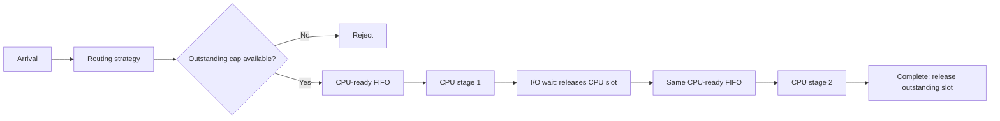

# CPU/I/O routing research (A-24)

This is a small standalone experiment prompted by the professor's feedback.
It is not wired into the web app, API or saved-run formats and does not change
existing single-pool/regional routing. It is advanced research; no new Demo 3
commitment or mentor agreement is implied.



The server has a finite number of non-preemptive CPU slots and a separate maximum
number of outstanding requests. A request stays assigned to its initial server.
Both CPU stages join the same ready FIFO. I/O completion rejoins that queue
without needing new admission capacity. The I/O resource itself is unbounded:
this models a delay, not shared database contention or network traffic.

For example, requests arriving at 0 and 0.1 seconds, each needing one second CPU,
two seconds I/O, then one second CPU, complete at 4 and 5 seconds with one CPU
slot. At time 2, both requests are in I/O, zero are CPU-active and two are still
outstanding. A cap of two would reject a new request even with the CPU idle.

The Python policy registry has a separate `cpu_io` topology. Round robin,
least-active and P2C are reused/registered there. Least-active and P2C observe
**CPU-active requests**, not all outstanding HTTP requests. This is a deliberate
experimental load signal; it is not a claim to reproduce Envoy's least-request
semantics. Existing web-app policy eligibility and menus are unchanged.

P2C samples two distinct servers and selects the one with fewer CPU-active
requests; equal counts choose the first sampled server. Its per-run RNG is
separate from workload generation. This is a defined P2C variant, not a proxy
conformance test. No control-plane service is added: configuration selects the
strategy; the event loop executes each per-request data-plane choice.

## Run and inspect

After installing the repository's locked dependencies:

```sh
PYTHONPATH=src uv run python experiments/compare_cpu_io.py --output experiments/results/a-24-rerun
PYTHONPATH=src uv run python -m unittest discover -s tests -q
```

The experiment takes seconds on a local CPU. It compares eight one-slot servers,
eight outstanding places per server, CPU-heavy/I/O-heavy/mixed requests, three
traffic rates and three seeds. Each of 27 generated traces is shared exactly by
all three policies. All 81 results are rerun for exact deterministic equality.
No cloud, GPU or extra package is needed. An explicit rerun directory preserves
checked-in evidence. Outputs are `samples.csv` (81 rows), `traces.json` (27 trace
inputs), `report.json` (configurations, source and result hashes) and `analysis.md`.

Mean/p95 latency cover completed requests through draining and must be read
alongside rejection. CPU occupancy, mean I/O-waiting, mean CPU-ready queue and
mean outstanding counts integrate over the arrival window. CPU occupancy is a
modeled slot measure, not actual host CPU usage. Per-event assertions enforce
CPU bounds, admission caps, unique lifecycle completion and conservation.

The checked-in [results](../experiments/results/a-24/analysis.md) are limited to
regular arrivals, one fleet size, no network model and three seeds. They are not
a general policy ranking, fault-tolerance result or performance benchmark.
Tests include exact hand-calculated timelines, FIFO re-entry, tied completions,
admission during I/O wait, workload identity, P2C's sampled-choice rule, resource
accounting and final draining. Existing simulator compatibility tests still run.

## Initial findings

In the I/O-heavy 400 requests/s case, three-seed mean rejection is 0% for round
robin, 30.31% for CPU-only least-active (range 30.0–30.6%), and 3.38% for P2C
(range 3.175–3.65%). Mean modeled CPU occupancy is 49.7%, 34.6% and 48.1%,
respectively. CPU-only selection can route into an outstanding cap while CPU
slots are available elsewhere. Lowest-index ties also concentrate work; these
results combine that tie behavior with the load signal, rather than isolating
one cause. Successful-request p95 stays around 119 ms, hiding the rejection gap
if reported alone.

P2C is not universally better: with CPU-heavy work at 100 requests/s, round robin
rejects 7.27% versus P2C's 11.17%. These workload-specific outcomes motivate a
future comparison with an outstanding-request signal; that fourth policy is not
part of this small slice. Adding CPU/I/O stages does not establish fault tolerance.
