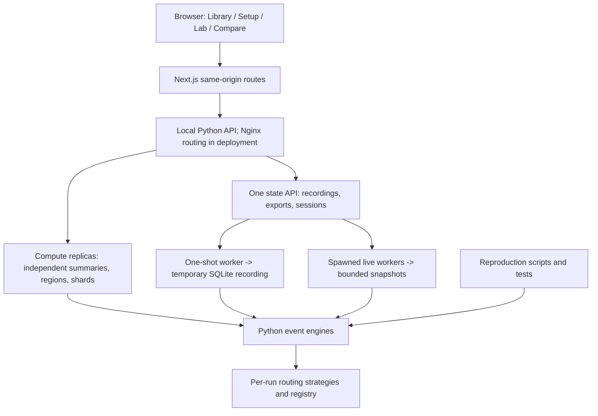

# Demo 3 design document: load balancing simulator

**Team:** Daniel Thomas, Kimone Walker, Neev Jain, Sean O'Connor

**Mentor:** Shripad Nadgowda (Meta)

**Updated:** November 12, 2026

**Implementation audited for the November 12 measurements:** `demo-3` at `c07af2150d3f36dcbe5f512e6139217b57d72a01`

**Submission:** November 16, 2026, noon, America/New_York, branch `demo-3`

## Problem and evaluation goals

Uneven load, hidden queued work, and slow dependencies can produce rejections
and long response times even when some capacity appears idle. Load Balancing
Lab investigates these effects with repeatable simulated workloads. Its goal
is to explain routing and resource tradeoffs, not to predict production fleet
capacity. Policies within a comparison see the same offered work, including
requests that are subsequently rejected.

The [Next.js Lab](../src/frontend/README.md) runs repeatable experiments on the
Python simulator. Since Demo 2 we added queue-aware routing and paired policy
comparisons, live sessions, regional and staged workloads, sharded dependencies
with seeded outages, and a paginated playback API. The [PDF](../slides/demo-3.pdf)
and [video](../videos/demo-3.mp4) show the main Demo 3 workflows. The
`demo-2` branch preserves the previous submission.

### Progress against the proposal and grading rubric

The [Demo 3 rubric](https://ec528.github.io/ec528/fall26/grading/#demo-3)
assigns 50% to progress, 20% to this document, and 10% each to code quality,
slides, and technical depth. Its milestone bar requires numerical improvement
over Demo 2 on meaningful workloads. The table connects the
[original proposal](design-proposal.md) to implemented work and evidence.
These are current measured acceptance checks; the original proposal did not
state these numerical targets, and this document does not claim mentor approval
of revised milestones.

| Commitment or extension | Demo 2 baseline | Demo 3 evidence and acceptance check |
| --- | --- | --- |
| Profile and improve a measured bottleneck | List front-removal of pending arrivals; original 10,000-request benchmark | Published snapshot medians improve 1.19-1.62x with matching traces and metrics. The isolated deque study improves 2.76-4.31x at 100,000 requests with exact full-summary fingerprints. See Experiments 3/4 and [snapshot comparison](#published-demo-2-vs-demo-3). |
| Implement and compare load feedback | Round-robin prototype | Running-only least active and queue-aware least outstanding; 36 policy runs and exact API replays on twelve shared traces. Near-capacity p95 is 2.13/5.24/1.23 s, with rejection 0/2.91/0%. See the [Demo 3 experiments](#demo-3-experiments). |
| Save, replay, and compare simulations | In-memory recorded-event playback | Version-one JSON/CSV, fingerprint-verified replay, and validated saved-result comparison; complete replayed summaries/events match. Experiments 2/5. |
| Make larger results usable | Legacy full-trace API response | Initial decoded response falls from 7,870,218 to 4,097 bytes for the reference 100-server/100,000-request case; paginated events reconstruct the original trace. [Playback validation](#recorded-playback-and-scale). |
| Selected advanced models | Identical servers in one region | CPU/I/O, live controls, regional spillover and client migration, shard slowdown/outages, and manual compute scaling. The regional example changes 173 rejections to zero out of 650 requests. These extensions supplement the core milestones. |
| Reproducible deliverables | Earlier slides, document, video | Demo 3 code, [slides](../slides/demo-3.pdf), [video](../videos/demo-3.mp4), setup, commands, expected results, and limitations in this document. Presence does not establish presentation quality or a guaranteed grade. |

The 10,000- and 100,000-request studies address engine scaling and transfer cost.
The smaller regional and shard examples isolate routing and failure behavior;
they are not production-scale capacity benchmarks. Advanced goals were optional
in the proposal. Unimplemented portions and submission checks are listed below
rather than silently treated as completed milestones.

## 1. Architecture



| Path | Responsibility |
| --- | --- |
| `src/frontend/` | Setup and templates, policy comparisons, recorded playback, live commands, and shard timelines. |
| `src/lbsim/api.py`, `runs.py`, `sessions.py` | HTTP validation, recorded-run paging, worker lifecycle, and bounded snapshots. |
| `src/lbsim/simulation.py`, `staged.py`, `continuous.py` | Single-pool event processing for simple and CPU/I/O workloads. |
| `src/lbsim/policies.py` | Single routing registry with policy-specific state and deterministic ties. |
| `src/lbsim/regional_engine.py`, `fanout.py` | Regional routing with transit delay and separate sharded service experiments. |
| `src/lbsim/app.py` | Earlier Streamlit interface, including saved JSON/CSV workflows. |

The browser displays Python results. A one-shot run finishes before the browser
scrubs its recorded timeline. A continuous worker owns its clock, accepts
commands, and returns snapshots while the run is active. The browser reads pages
of server data instead of receiving the full event log at startup.

Single Pool supports simple service or CPU → I/O → CPU, with either execution
mode. Regions uses aggregate pools and configurable transit delays. Sharded
Service models one coordinator waiting for required parallel or serial replies.
Sharded experiments run one-shot and isolate dependency slowdown or outages.
See [CPU/I/O](cpu-io-lab.md), [regions](regional-api.md), [fan-out](fanout-pipeline.md),
and [routing policies](routing-policies.md) for the model boundaries.

[Docker Compose](docker-compose.md) and [Kubernetes](kubernetes.md) separate web
and independent compute replicas from the single owner of sessions and
recordings. Restarting the state owner expires its in-memory state.

Local development uses one Python API process for both roles. Compute replicas
can serve independent requests; stateful IDs belong to one owner. This is not
distributed session ownership, autoscaling, or automatic failover.

| Model | Supported execution | Boundary |
| --- | --- | --- |
| Simple single pool | One-shot and continuous | Finite execution slots, bounded waiting FIFO, service-demand sampling, optional processing-rate multipliers. |
| Main Lab CPU/I/O | One-shot and continuous | CPU -> shared finite I/O -> CPU, with CPU-ready FIFO and per-server outstanding admission caps. I/O releases CPU but retains admission capacity. |
| Regions | One-shot and continuous | Aggregate compute pools, configurable request/reply transit, and current load knowledge. Continuous runs support manual datacenter outages and optional client migration. No per-server regional scheduling or delayed telemetry. |
| Sharded service | One-shot | Coordinator, one/two/four required calls, parallel/serial dispatch, CPU/I/O, deadlines, slowdown, and a seeded outage with recovery. |
| A-24 research | Script and research view | Separate CPU/I/O model with unbounded I/O delay. Its results do not characterize the main Lab's finite shared I/O resource. |

### Recorded results and live state

`POST /v1/runs` returns exact single-pool metrics, at most 20 histogram bins,
per-server utilization, and a recording ID. Empty event/sample compatibility
arrays do not mean no events occurred. The legacy `/v1/run` still returns the
full trace; Compare uses `/v1/run-summary` without creating a recording.
SQLite indexes support stable event pages (at most 1,000 rows) and selected-time
server snapshots (at most 64 rows; the UI requests 32).

Recordings default to four runs, a 64 MiB retained-file budget, and a ten-minute
absolute TTL. Reads do not renew the TTL. Generation still needs temporary
staging and bounded full results in memory. Paging reduces initial transfer
and retained trace allocation, not all transient engine/IPC allocation.

Live sessions default to two workers, 2,000 recent response samples, 240 history
points, and 128 command records. A tick has a 10 ms processing budget and a
20,000-event ceiling. Idle/absolute lifetimes default to 300/3,600 seconds.
Pause freezes time; zero traffic while running drains outstanding work.
Sequential polls and cancellation prevent overlapping/stale reads. Expiry,
worker failure, and API restart loss are explicit states. The session owner is
temporary, not a database. See [recordings](recorded-runs.md) and
[session lifecycle](continuous-api.md).

### Simple single-pool configuration and lifecycle

All times are simulated seconds. Server IDs start at zero. Each request occupies
one execution slot for its full service time.

| Key | Meaning and validation |
| --- | --- |
| `server_count` | Positive integer number of identical servers. |
| `concurrency` | Positive integer execution slots per server. |
| `queue_limit` | Nonnegative integer waiting places per server, excluding running work. Zero disables waiting. |
| `arrival_rate` | Positive finite requests per simulated second. |
| `duration` | Positive finite arrival-window duration; also the utilization window. |
| `service_min`, `service_max` | Positive finite service bounds, minimum no greater than maximum. Equal bounds produce fixed service times. |
| `seed` | Integer; negative values are valid. |
| `policy` | The simple pool supports `round_robin`, `least_active_requests`, `least_outstanding`, and `power_of_two`. Least Active counts running requests. Least Outstanding also counts queued work. Both minimum policies break ties by lowest server ID. |

The engine generates `N = int(arrival_rate * duration)` requests, IDs `0..N-1`.
Request `i` arrives at `i / arrival_rate`; service time is sampled with a local
`random.Random(seed).uniform(service_min, service_max)`. Generation precedes
routing. A positive rate/window produces an empty trace when their product is
less than one.

Round-robin assigns request `i` to server `i % server_count`, regardless of load.
A free slot starts work. Otherwise the selected server queues it in FIFO order
if space exists, or rejects it. There is no retry or alternate-server attempt.
Completion frees a slot and immediately starts the oldest queued request; the
engine schedules that request's completion.

Least-active-requests instead selects the minimum `(running_count, server_id)`
before each arrival. Admission and every completion/queue promotion update the
in-memory state used by the next decision. Queue lengths are deliberately absent
from the signal. When all one-slot servers are busy, their running counts tie,
so the lowest-ID server can receive more work despite an already-full queue.
Neither policy retries a different target after rejection. This is the defined
basic load-feedback policy, not a general claim of optimal load balancing.

Completions precede arrivals at equal timestamps. Pending completions sort by
`(completion_time, server_id, request_id)`, breaking completion ties by server ID
then request ID. Generated arrivals follow request-ID order. After the last
arrival, accepted work drains until no pending completions remain. The event
clock jumps between events without sleeping.

Recorded events have shape
`(time, server_id, running_count, waiting_count, action, request_id)`.
Counts describe the server after the event. Actions are `started`, `queued`,
`rejected` or `completed`. A completion that promotes queued work includes that
promotion in its counts; it emits no separate start event for the promotion.

### Metrics and returned data

`run_simulation` returns the dictionary below. Configuration remains a separate
input. For raw executions and rejected IDs, the lower-level
`route(**config, events=events)` returns `(completed_executions, rejected_request_ids)`.

| Summary key | Definition |
| --- | --- |
| `completed_count` | Requests completed after fully draining accepted work. |
| `rejected_count` | Requests whose selected server could neither run nor enqueue them. |
| `mean_response_time` | Mean `completion_time - arrival_time` for completed requests, including waiting and draining. |
| `p95_response_time` | Nearest-rank p95: sorted response time at zero-based index `ceil(0.95 * n) - 1`. |
| `per_server_utilization` | Server ID to occupied slot-seconds divided by `concurrency * duration`. Each execution contributes `max(0, min(completion_time, duration) - max(start_time, 0))`. |
| `response_times` | Completed-request response times in completion order. |
| `events` | Ordered admission/completion state changes for playback. |

Latency excludes rejected requests and includes completions after the arrival
window. Both latency values are `None` for no completions; the UI shows `N/A`.
Empty runs have zero counts and utilization. Utilization clips executions to
`[0, duration]`, excluding draining beyond the window. It measures modeled slot
occupancy, not CPU usage; for valid schedules it lies in `[0, 1]`. After draining,
completed plus rejected equals generated requests and every server is idle.
Tests and the benchmark check these properties.

## 2. Design decisions

- **One authoritative engine:** the browser uses the Python API. Experiments can
  call the same package directly, and benchmark samples can use fresh processes.
  Deployment can scale independent runs while keeping session state on one owner.
- **Event-driven execution:** jumping between events separates simulated time
  from machine scheduling; threads and sleeps would introduce timing variation.
- **Separate routing and admission:** the engine selects a target; `Server`
  owns slots, queue capacity and FIFO behavior, including rejection on a full target.
- **Repeatability:** a local random generator and new server objects isolate
  runs from each other and global random state. Arrivals use fixed intervals;
  the seed controls sampled service durations.
- **Drain latency, clip utilization:** accepted requests finish before latency
  calculation, while occupancy stays tied to the arrival window.
- **Recorded playback:** replay changes the display clock using saved events;
  it does not re-route requests or change metrics.

- **Explicit load signal and ties:** fewest running requests and smallest-ID
  tie-breaking make policy decisions deterministic. Including queues, rotating
  ties or skipping full targets would change the policy definition. The measured
  admission/latency tradeoff is documented in Experiment 6; those alternatives
  are not silently introduced to improve its results.
- **Versioned portable files:** configuration/seed and schema version live in
  JSON; global metrics and all server utilizations live in CSV. A shared content
  fingerprint links them without relying on a server database. Replay checks
  exported metrics before changing active results; comparison leaves them intact.
- **Narrow measured optimization:** pending arrivals use `collections.deque`
  and `popleft()` rather than a list and `pop(0)`. The entire workload is still
  generated first; the completion list, policies, admission and event order are
  unchanged. Profiling suggested the issue, and matched output fingerprints plus
  unprofiled timings establish the measured improvement (Experiments 3 and 4).

## 3. Setup

The primary runbook uses a POSIX shell on Linux or macOS. CI runs on Ubuntu
with Node.js 24. Install Git, Python 3.12 (including `venv`), and Node.js 24
with npm. The audit used uv 0.11.32; the bootstrap below pins that working
version. uv selects Python 3.12 from `.python-version`.
`uv.lock` and `src/frontend/package-lock.json`
pin application packages; this snapshot locks Streamlit 1.67.0, Next.js 16.4.3,
and React 19.3.1. Historical measurements retain their original recorded versions.
The Dockerfiles select uv 0.13.7, Python 3.12-slim, and Node 24-bookworm-slim;
base-image tags are not immutable digests.

No GPU, cloud credentials, external dataset, or database service is needed.
Internet access is needed for cloning and package/browser installation. A local
CPU is sufficient. For a clean evaluation machine, 4 CPU cores, 8 GiB RAM, and
5 GiB free disk are a starting allocation, not a measured minimum. Larger
builds/runs may need more. Reserve 8000/3000 for ordinary use and 8001/3001 for
isolated benchmarks. Allow several minutes for first installation.

Install Git, Python 3.12, and Node.js 24 using your OS packages or official
installers. On Linux, install your distribution's Python venv package if it is
separate. Bootstrap uv in a temporary environment, then clone the submission:

```sh
tool_env=$(mktemp -d)
python3.12 -m venv "$tool_env"
"$tool_env/bin/python" -m pip install uv==0.11.32
export PATH="$tool_env/bin:$PATH"
git clone --branch demo-3 https://github.com/ec528-fall26/load-balancing.git
cd load-balancing
git rev-parse HEAD
uv --version
node --version
npm --version
uv sync --locked
npm --prefix src/frontend ci
```

Record the resolved commit and versions with a rerun. This document's review
branch must be merged into `demo-3` to enter the graded snapshot.
The [course setup requirements](https://ec528.github.io/ec528/fall26/setup/#instructions-the-ta-can-run)
require a teammate to follow the final instructions from a clean environment.

Start the API in terminal A, with one worker for local state ownership:

```sh
uv run --locked python -m uvicorn lbsim.api:app --host 127.0.0.1 --port 8000 --workers 1
```

In terminal B, from the repository root:

```sh
curl -fsS http://127.0.0.1:8000/health
LBSIM_API_URL=http://127.0.0.1:8000 npm --prefix src/frontend run dev
```

Expect health JSON containing `"status":"ok"`; open
[Setup](http://127.0.0.1:3000/setup). The [README](../README.md#quick-start)
provides the routing, live-traffic, and outage walkthroughs. On PowerShell, set
`$env:LBSIM_API_URL='http://127.0.0.1:8000'` before running npm; inline variable
assignments and historical shell loops below require a POSIX shell.
`python -m uvicorn` avoids an executable-shim block observed on Windows.

### Automated checks

```sh
uv run --locked python -m unittest discover -s tests -q
uv run --locked python scripts/generate_policy_metadata.py --check
npm --prefix src/frontend run build
(cd src/frontend && npx --no-install tsc -p tsconfig.api-tests.json && node --test .api-tests/tests/*.test.js)
(cd src/frontend && npx --no-install playwright install --with-deps chromium)
LBSIM_API_URL=http://127.0.0.1:8000 PLAYWRIGHT_CHANNEL=chromium npm --prefix src/frontend test
```

Expect 148 Python tests with `OK`, a successful metadata check/build, 23 passing
Node module tests, and no failed browser cases. Keep the API running. Stop the
interactive frontend before Playwright starts its own server on port 3000.
The default config otherwise selects Edge; explicitly selecting Chromium makes
this command portable. Allow roughly 30-120 seconds for Python, 1-3 minutes for
a cold build, and 2-10 minutes for browser checks after installation. Slower
machines may exceed these estimates. These categories also run in
[CI](../.github/workflows/tests.yml); counts identify the audited snapshot.

The worked example and JSON/CSV instructions below reproduce the earlier
Streamlit baseline with `uv run streamlit run src/lbsim/app.py`. For the three
current Lab workflows, follow the [Demo 3 quick start](../README.md#quick-start).

### Short worked example: overload and draining

Use one server, one slot, one waiting place, 4 requests/s, a 1-second arrival
window, both service bounds 1 second, and seed 42. Reproduce it without a browser
with this command from the repository root. Allow roughly 10 seconds including
command startup after dependencies are installed; the four-request simulation
itself is much shorter. It needs only the local Python environment, with no
cloud resources or GPU:

```sh
uv run python -c "from lbsim.simulation import run_simulation; c=dict(server_count=1,concurrency=1,queue_limit=1,arrival_rate=4.0,duration=1.0,service_min=1.0,service_max=1.0,seed=42,policy='round_robin'); s=run_simulation(c); print({k:s[k] for k in ('completed_count','rejected_count','mean_response_time','p95_response_time','per_server_utilization','response_times')})"
```

Expected output:

```text
{'completed_count': 2, 'rejected_count': 2, 'mean_response_time': 1.375, 'p95_response_time': 1.75, 'per_server_utilization': {0: 1.0}, 'response_times': [1.0, 1.75]}
```

| Time (s) | Event | Running / waiting after event |
| ---: | --- | --- |
| 0 | Request 0 starts; completion scheduled at 1. | 1 / 0 |
| 0.25 | Request 1 queues. | 1 / 1 |
| 0.5 | Request 2 is rejected. | 1 / 1 |
| 0.75 | Request 3 is rejected. | 1 / 1 |
| 1 | Request 0 completes; request 1 immediately starts. | 1 / 0 |
| 2 | Request 1 completes; server is idle. | 0 / 0 |

Request 1 waits 0.75 seconds and runs for 1 second: response time is 1.75 seconds.
Mean response time is `(1 + 1.75) / 2 = 1.375` seconds. The slot occupies the
entire arrival window, giving 100% utilization. Completion at 2 seconds contributes
to latency; occupancy after 1 second does not contribute to utilization. UI cards
show `2`, `2`, `1.375 s` and `1.750 s`. Seek to 0.25 seconds to see one running
and one waiting request, then to 2 seconds to see two completed, two rejected
and zero running/waiting.

For a normal run, keep other settings and change both service bounds to 0.1 seconds.
All four requests complete, none are rejected, mean/p95 are 0.100 seconds and
server utilization is 40%.

### Downloading a completed run (D3-03)

Open **Download run** below the results to save configuration/seed as versioned
JSON and results as CSV. The files describe the last completed run, including
when form inputs have been edited but not submitted. CSV contains whole-run
metrics and one utilization row per server. Empty-run latency cells are blank.
See [the export format](run-exports.md) for every field and the real-run example.

The saved-run contract is schema version `1`:

| File | Required data and interpretation |
| --- | --- |
| Configuration JSON | Top-level `schema_version`, 64-character `run_id`, and `config` containing all nine settings, including policy and integer seed. |
| Results CSV | `schema_version`, `run_id`, all nine configuration values, generated/completed/rejected counts, mean/p95 response times in seconds, `server_id` and `slot_utilization`. Exactly one row per configured server, including idle servers. |

Global counts and latency repeat in CSV rows and must be read once, not summed.
Only server ID/utilization vary. Utilization is a fraction, not percent; UI panels
multiply it by 100. No-completion latency is blank in CSV, rather than zero. All
files are UTF-8; loaders accept an optional BOM and limit each upload to 5 MiB.
Missing/extra fields, unsupported versions, inconsistent rows, invalid types,
duplicate server IDs or changed fingerprints produce errors.

The SHA-256 ID covers schema, configuration and exported metrics. It is
deterministic rather than an execution timestamp, and is not authentication.
Files omit original events, individual requests, response-time samples and the
engine/dependency bundle. Replay regenerates those details using the current
model and verifies the exported metrics; an original file alone cannot prove
that an omitted event history is identical. Exact field definitions, accepted
inputs and example files are in [the saved-run contract](run-exports.md).

### Reloading and comparing saved runs (D3-04/05)

In the sidebar, **Replay a saved run** accepts version-one configuration JSON.
Inspect its settings and click **Replay saved configuration** to regenerate the
simulation. Results replace the active run only after their export fingerprint
matches the saved ID. Playback then resets to paused at time zero. Invalid files
or mismatches display errors and preserve current results; the settings form is
independent of loaded settings.

**Compare saved results** accepts two original CSV exports without an active run.
It shows policies, configuration differences, latency, rejection rates, mean
server utilization and per-server tables. Different workload/capacity settings
are flagged. It reads saved metrics without simulating or changing active results.
Both formats are checked for schema, types, consistency and fingerprints, with a
5 MiB per-file limit. See [the saved-run guide](run-exports.md) for exact rules.

## 4. Running the experiments

The existing benchmark measures the full `run_simulation` call, including
generation, routing, event recording, draining and metrics. Each sample uses
a fresh process. Startup/imports and post-run checks are excluded from timing.
Peak memory is the OS process high-water mark, including interpreter/imports,
read before post-run validation; it is not incremental or whole-machine memory.

### Experiment 1: D2-13 round-robin scale baseline

| | |
| --- | --- |
| Supports | Local baseline runtime and peak process memory for the same 10,000-request trace with 10, 100 and 1,000 servers. |
| Setup | From the repository root, install uv and run `uv sync --locked` (Python 3.12 is selected by `.python-version`). |
| Command | `uv run python experiments/scale_benchmark.py --repeats 3 --output experiments/results/d2-13-rerun` |
| Expected runtime | Typically under one minute on the recorded machine; each worker has a 120-second timeout. |
| Expected output | Nine sample lines, followed by `trace.csv`, `samples.csv`, and `report.json` in the chosen directory. A different directory preserves the saved baseline. |

For each invocation, the script generates a reference trace and writes it to the
chosen output directory. Every worker's generated workload hash must match that
reference. The script also verifies seeded replay, request conservation, idle
servers after draining, and consistent deterministic results across repetitions.
These checks do not automatically compare a rerun with the checked-in baseline.
To compare with that baseline, check the trace hash in `report.json` and the
counts, latency metrics and final event times in `samples.csv` against the files
in `experiments/results/d2-13/`. All nine samples matched those deterministic
fields in the October 20 verification. Wall-clock time and peak memory vary by
machine and load. This experiment is a round-robin baseline, not a comparison of
routing policies.

The workload uses 100 requests/s for 100 seconds, seed 42, service times 0.1-1.0
seconds, one slot and ten waiting places per server. Recorded Windows baseline,
three samples per server count:

| Servers | Median runtime (s) | Maximum peak process memory (MiB) | Completed | Rejected |
| --- | ---: | ---: | ---: | ---: |
| 10 | 0.0752 | 35.41 | 1,905 | 8,095 |
| 100 | 0.1351 | 37.79 | 10,000 | 0 |
| 1,000 | 0.1275 | 38.66 | 10,000 | 0 |

See [methodology](../experiments/README.md),
[raw samples](../experiments/results/d2-13/samples.csv),
[machine/configuration report](../experiments/results/d2-13/report.json) and
[trace](../experiments/results/d2-13/trace.csv). Increasing server count also adds
capacity. Ten servers reject most requests. These results do not isolate the
cost of server count or prove 1,000 servers faster than 100.

### Experiment 2: export a real run

Run `uv run python experiments/export_run.py --output experiments/results/d3-03-rerun`
from the repository root. It completes in seconds and writes configuration JSON
and results CSV for a fixed overload case. Expect two completions, two rejections,
mean/p95 response times 1.375/1.75 seconds and utilization 1.0. The checked-in
[example files](../experiments/results/d3-03/config.json) and
[format documentation](run-exports.md) describe the expected output. A separate
output directory preserves those reference files.

### Experiment 3: D3-06 engine profiling

Run `uv run python experiments/profile_engine.py --output experiments/results/d3-07-rerun`
from the repository root. It profiles the current deque implementation at
10,000 requests and a longer
100,000-request workload, with 10/100/1,000 servers and three unprofiled timings
per case. Only the arrival window grows for the longer workload. Allow roughly
30 seconds locally; each fresh worker has a 120-second timeout. No cloud or GPU
is needed. Output: a new `report.json`, six raw cProfile files and one printed
timing per case. The saved historical pre-change capture is separately preserved
in [D3-06 report.json](../experiments/results/d3-06/report.json); running the
current implementation does not recreate that older code.

Profiled and unprofiled runs must produce identical complete-summary fingerprints.
Each run also checks request conservation and idle final servers. Timing excludes
imports, startup, hashing and output; profiled times include instrumentation
cost and must not be compared directly with unprofiled runtime. Saved source
hashes identify the measured code, including files not yet committed at the time
of the historical captures.

The [analysis and narrow D3-07 plan](../experiments/results/d3-06/analysis.md)
identify list front removals as a scaling issue. The saved before-change
capture remains unchanged. At 100 servers, its unprofiled median grew from
0.0389 to 1.0304 seconds for 10,000 versus 100,000 requests (26.5x for 10x more
requests). Combined list-pop self time accounted for 37-48% of profiled time in
the 100,000-request cases. cProfile combines arrival and pending-completion pop
sites, so this is neither an isolated arrival-pop cost nor a predicted speedup.
See the [raw pre-change captures and function statistics](../experiments/results/d3-06/report.json).

### Experiment 4: D3-07 deque improvement

Pending arrivals now use `deque.popleft()` instead of `list.pop(0)`. The entire
seeded trace is still generated before routing. Completion sorting, routing,
queue admission and event ordering are unchanged.

To reproduce the published calculation from the preserved matching captures:

```sh
uv run python -X utf8 experiments/compare_profiles.py experiments/results/d3-06/report.json experiments/results/d3-07/report.json --output experiments/results/d3-07-comparison-rerun.json
```

Comparison takes under a second locally, prints six timing ratios and writes
the specified JSON. `-X utf8` also supports the script's Unicode timing arrows
on Windows terminals with a legacy default encoding. It checks that the two reports have matching Python,
platform, architecture, Streamlit, configurations, outcome/event counts and full
summary fingerprints. It compares unprofiled medians, not instrumented timings.
Source records: [before](../experiments/results/d3-06/report.json),
[after](../experiments/results/d3-07/report.json),
[calculated ratios](../experiments/results/d3-07/comparison.json) and
[interpretation](../experiments/results/d3-07/analysis.md).

| Requests | Servers | Before median (s) | After median (s) | Before / after |
| ---: | ---: | ---: | ---: | ---: |
| 10,000 | 10 | 0.0238 | 0.0186 | 1.28x |
| 10,000 | 100 | 0.0389 | 0.0343 | 1.14x |
| 10,000 | 1,000 | 0.0394 | 0.0351 | 1.12x |
| 100,000 | 10 | 0.8649 | 0.2007 | 4.31x |
| 100,000 | 100 | 1.0304 | 0.3636 | 2.83x |
| 100,000 | 1,000 | 1.0615 | 0.3846 | 2.76x |

Each median uses three fresh-process unprofiled runs. Original timing captures
used macOS arm64, Python 3.12.12 and Streamlit 1.65.0 as recorded in those reports.
These are matched sequential batches on one machine, not the Windows D2 timing
environment; do not divide D2 timings by these timings to claim optimization.
All six complete summaries match before/after. The historical optimization
validation used 39 tests; the audited integrated suite now contains 148.

Experiment 3 can collect a new after-change report on another machine. Comparing
that report directly with the original macOS capture will correctly fail the
environment check if environments differ. To measure a new speedup, collect
both the list-arrival engine and deque engine with this same profiling script,
configuration and Python/dependencies on the same machine, using separate output
directories. The saved source hashes identify the original pair. No new before
capture or unmeasured speedup is assumed by this document.

Removing arrival-list shifts improves these measured cases, especially the
larger traces. It does not establish overall linear complexity: completion-list
front removals/sorting, least-active selection, metrics and full-trace storage
remain. No memory reduction, cloud throughput or policy-superiority claim follows.

### Experiment 5: saved configuration replay and side-by-side results

Run `uv run python experiments/replay_compare.py --output experiments/results/d3-04-05-rerun`
from the repository root. In seconds it writes two exported JSON/CSV pairs and
`verification.json`, checking complete original/replayed summaries and reading
back both CSVs. Both runs have 16 arrivals with the same seed and workload;
round-robin completes/rejects 9/7 requests, least-active-requests 7/9. This checks
the save/replay/compare workflow, not a general policy-performance claim.
Use the [reference files and UI instructions](run-exports.md#reproduce-replay-and-comparison-evidence)
to reproduce the panels. A separate output directory preserves saved evidence.

### Experiment 6: D3-02 paired policy comparison

```sh
uv run python experiments/compare_policies.py --output experiments/results/d3-02-rerun
```

Run from the repository root; allow a few seconds locally, with no GPU or cloud
resources. There are 24 policy runs plus 24 public-API replays: four fixed-load
scenarios, three seeds (42/43/44) and both policies. The fleet has 10 identical
single-slot servers, 10 waiting places each, a 100-second arrival window and
uniform 0.1–1.0 second service. Nominal capacity is 18.1818 requests/s. The rates
are 50%, 90%, 120%, and 90% increased by 20% (108% of nominal capacity).

Output contains 12 reference traces, samples.csv, server-utilization.csv and
report.json with every configuration, seed, workload hash, summary fingerprint
and aggregate. Observed requests must equal the reference for each policy;
validation also checks state-based target selection, capacity, conservation,
FIFO, draining and exact agreement with the public API replay.

The nominal capacity reference is `10 / ((0.1 + 1.0) / 2) = 18.1818` requests/s,
based on expected service time, not a guarantee of zero rejections. Rates are
9.0909 (low), 16.3636 (near capacity), 21.8182 (overload), and 19.6364 requests/s
(near capacity increased by 20%). The last case is an independent run at 108% of
nominal capacity, not a traffic spike during a continuous simulation. Exact
floating-point rates/configurations are preserved in the report.

#### Policy results and variation

Sources: [per-run samples](../experiments/results/d3-02/samples.csv),
[aggregates and configurations](../experiments/results/d3-02/report.json),
[per-server utilization](../experiments/results/d3-02/server-utilization.csv),
[trace files](../experiments/results/d3-02/traces/low-seed-42.csv) (all twelve are
listed by the report), and [analysis](../experiments/results/d3-02/analysis.md).
Each row below averages the three seed results. Ranges are seed minima/maxima,
not confidence intervals. SD is the sample deviation of the three seed means.
The p95 column averages per-run p95s; it is not a pooled request percentile.

| Scenario | Policy | Rejected %, mean [range] | Mean response s, mean +/- SD | Per-run p95 s, mean [range] | Mean utilization % |
| --- | --- | ---: | ---: | ---: | ---: |
| Low | Round-robin | 0.00 [0.00-0.00] | 0.546 +/- 0.010 | 0.953 [0.947-0.962] | 49.45 |
| Low | Least-active | 0.00 [0.00-0.00] | 0.546 +/- 0.010 | 0.953 [0.947-0.962] | 49.45 |
| Near capacity | Round-robin | 0.00 [0.00-0.00] | 0.952 +/- 0.042 | 2.126 [2.023-2.237] | 88.97 |
| Near capacity | Least-active | 2.91 [2.69-3.36] | 1.048 +/- 0.015 | 5.235 [5.137-5.291] | 86.23 |
| Overload | Round-robin | 12.21 [11.55-13.20] | 4.740 +/- 0.141 | 6.912 [6.797-7.084] | 99.50 |
| Overload | Least-active | 22.50 [21.50-23.89] | 1.135 +/- 0.014 | 6.001 [5.924-6.059] | 92.23 |
| Near +20% | Round-robin | 3.65 [3.06-4.58] | 3.720 +/- 0.205 | 6.474 [6.385-6.615] | 98.88 |
| Near +20% | Least-active | 15.44 [14.42-16.40] | 1.124 +/- 0.014 | 5.891 [5.771-5.962] | 90.54 |

At low load both accept every request with zero waiting and matching response
metrics. Aggregate utilization hides imbalance: the mean across seeds of
population server-utilization SD is 0.0254 for round-robin and 0.3463 for
least-active, in fraction units. Idle-server ties favor low IDs, concentrating
light traffic. Those exact per-seed values are in the utilization/report sources.

Near capacity, round-robin rejects none; least-active rejects 2.91% on average
and has worse mean/p95 latency. A running-only count ignores queued work. When
all one-slot servers are busy, every count is one and the lowest-ID tie funnels
new arrivals toward server 0 even if its queue is full.

Under overload and near +20%, least-active has lower completed-request mean
latency but rejects substantially more work. Rejected requests have no response
time in these statistics, so this is an admission/latency tradeoff, not an
overall win. In the saved dataset every rejection occurs while another queue
has waiting room, for both policies; `rejected_with_other_queue_space` in the
per-run samples records the check. Neither policy retries another target.

The experiment therefore supports reporting latency, rejection and utilization
together. It does not justify changing the agreed policy or claiming a universal
ranking. Three seeds, one fleet/service distribution and regular arrivals give
descriptive variation, not statistical significance. No CPU-runtime comparison
between policies, bursty traffic, continuous execution, failures or retries is
measured here. Historical study metadata records macOS arm64 and Python 3.12.12;
deterministic results can be checked separately from machine-dependent timings.

### Experiment 7: A-02 routing on mixed-speed servers

| | |
| --- | --- |
| Supports | Routing outcomes on uniform and mixed-speed fleets with equal total capacity. |
| Command | `uv run python experiments/compare_speeds.py --output experiments/results/a-02-rerun` |
| Expected runtime | A few seconds on a local CPU. |
| Expected output | `Validated 54 runs on 9 shared traces.` See the [reference analysis](../experiments/results/a-02/analysis.md). |

## Demo 3 experiments

Run these from the repository root after `uv sync --locked`. Use a quiet local
machine for timings. The committed reports preserve the original environments
and workload hashes.

| Experiment | Command | Expected result |
| --- | --- | --- |
| Three-policy replay (slide 7) | `uv run python experiments/compare_policies.py --include-least-outstanding --output experiments/results/demo-3-policy-rerun` | A few seconds. Validates 36 runs and replays on 12 traces. In the `near_capacity` rows of `report.json`, average rejection and p95 are **0.00% / 2.13 s**, **2.91% / 5.24 s**, and **0.00% / 1.23 s** for Round Robin, Least Active, and Least Outstanding. |
| Deque optimization in isolation | [Matched-revision commands](../experiments/README.md#d3-07-deque-beforeafter-comparison) | The reference 100,000-request, 100-server run moved from 1.030 s to 0.364 s, or 2.83×, with matching full-summary fingerprints. Timing varies by machine. |
| Published Demo 2 vs. Demo 3 | [Commands and raw results](#published-demo-2-vs-demo-3) | Original 10,000-request Round Robin workload. Median engine runtime improved by 1.19×–1.62× across 10, 100 and 1,000 servers. The trace and reported simulation metrics matched. |
| Regional routing spillover | [Lab reproduction](#regional-routing-spillover) | At 130 requests/s for 5 seconds, Nearest rejects 173 of 650 requests. Nearest under 90% load completes all 650. |
| Recorded playback and scale | [Exact API startup and harness commands](#recorded-playback-and-scale) | Allow 1-3 minutes on a local CPU. The reference 100,000-request case reduced the initial decoded payload from 7.87 MB to 4.10 kB. The harness checks every paginated event against the full trace and verifies seek and live pause/drain. |
| Sharded service outage | `uv run --locked python experiments/compare_fanout_pipeline.py --outage > fanout-outage-rerun.json` | A few seconds. At 50 parents/s for four seconds with seed 42 and a 500 ms outage, 7 of 200 fail with one required call and 25 of 200 with four. Both no-outage controls finish all 200. [Output interpretation and slowdown controls](#sharded-service-slowdown-outage-and-call-order). |
| CPU/I/O and power-of-two choices | `uv run python experiments/compare_cpu_io.py --output experiments/results/a-24-rerun` | A few seconds. 81 paired runs on 27 traces. The [reference analysis](../experiments/results/a-24/analysis.md) defines the research model and expected comparisons. |

The three-policy command writes `samples.csv`, `server-utilization.csv`, twelve
trace CSVs, and `report.json` with per-run fingerprints, configurations, seed
ranges, and aggregate metrics. Expect `Validated 36 runs and public-API replays;
saved 12 shared traces and all metrics.` The historical two-policy report has
24 runs; use the explicit flag to reproduce the third policy rather than
assuming it is present in that older report.

The CPU/I/O command writes 81 samples, 27 traces in `traces.json`, `report.json`,
and analysis. For I/O-heavy 400 requests/s, the reference mean rejection is
0% round robin, 30.31% least active, and 3.38% power of two. This is the research
model's unbounded I/O delay, not the main Lab's finite shared I/O resource.
The distinction matters when reproducing or presenting those numbers.

The [Lab quick start](../README.md#quick-start) uses one trace for the video
comparison. The slide uses three traces at 90% of nominal capacity, with p95
averaged over the three per-run percentiles of completed requests.

### Published Demo 2 vs. Demo 3

Use the original D2-13 benchmark with each snapshot's locked environment.
Run from the quick-start checkout in a POSIX shell. Allow about 30 seconds
locally once dependencies are cached. A local CPU is sufficient.

```sh
git fetch origin demo-2
bench_dir=$(mktemp -d)
git worktree add --detach "$bench_dir/demo-2" 44e2683a7edbf37dc04f59ff273313718077a2ba
git worktree add --detach "$bench_dir/demo-3" ccfc4a48897a7c4bd21c348ac1a1745bc0ac60dc
for snapshot in demo-2 demo-3; do
  (
    cd "$bench_dir/$snapshot"
    uv sync --locked
    uv run --locked python experiments/scale_benchmark.py --repeats 3 --output "$bench_dir/results-$snapshot"
  )
done
cmp "$bench_dir/results-demo-2/trace.csv" "$bench_dir/results-demo-3/trace.csv"
```

The harness times engine calls in fresh processes. These are medians of
three runs per fleet on the same macOS arm64 machine (14 logical CPUs) and
Python 3.12.12. Each snapshot uses its own locked environment: Streamlit is
1.65.0 in Demo 2 and 1.67.0 in the measured Demo 3 snapshot.
Each case offered 10,000 requests. Completed and rejected counts, mean and
p95 response times, and the final simulated event time matched across snapshots.
See the [reports and all 18 samples](../experiments/results/demo-2-vs-demo-3/).

| Servers | Demo 2 median | Demo 3 median | Speedup | Completed / rejected |
| ---: | ---: | ---: | ---: | ---: |
| 10 | 21.2 ms | 13.1 ms | 1.62× | 1,905 / 8,095 |
| 100 | 35.5 ms | 29.2 ms | 1.22× | 10,000 / 0 |
| 1,000 | 35.1 ms | 29.4 ms | 1.19× | 10,000 / 0 |

The published snapshots include multiple code and dependency changes.
The separate deque experiment isolates the arrival-list change on 100,000 requests.

### Recorded playback and scale

Start an isolated API in terminal A; do not share it with an interactive session:

```sh
uv run --locked python -m uvicorn lbsim.api:app --host 127.0.0.1 --port 8001 --workers 1
```

In terminal B, after health succeeds:

```sh
curl -fsS http://127.0.0.1:8001/health
uv run --locked python experiments/pagination_scale.py --backend http://127.0.0.1:8001 --output pagination-demo-3-rerun.json
```

Allow 1-3 minutes locally. The output filename is relative to
`experiments/results/a-11/`, so this writes
`experiments/results/a-11/pagination-demo-3-rerun.json`. All three single-pool
cases offer 100,000 requests. The harness checks summary equality, histogram
counts, each paginated event against the legacy trace, stable sequence order,
and conservation at start/middle/end seeks. It also checks regional draining,
explicit topology limits, and live pause followed by zero-traffic drain.

Reference [raw measurements](../experiments/results/a-11/pagination-scale.json):

| Servers | Offered/s | Legacy decoded JSON bytes | Compact decoded JSON bytes | Reduction |
| ---: | ---: | ---: | ---: | ---: |
| 100 | 1,000 | 7,870,218 | 4,097 | 99.95% |
| 1,000 | 10,000 | 8,633,692 | 24,300 | 99.72% |
| 1,000 | 100,000 | 4,807,647 | 16,401 | 99.66% |

Compare exact simulation fields and page contents, not entire HTTP responses:
opaque IDs, metadata, timings, and serialization may differ. These are initial
decoded JSON sizes, not total playback transfer or compressed wire bytes.
The regional cases use 12 datacenters/1,000 servers/4,000 slots and illustrative
2-450 ms client RTTs. Each offers exactly 100,000 requests. The harness checks
that 1,001 **single-pool** servers and a separate 13-region topology both
produce validation errors. The current regional API allows up to 12 regions
and, across all regions, up to 100,000 servers, 400,000 execution slots, and
1,000,000 waiting places. These are configuration limits. The measured
regional runs use the smaller topology described above.

The reference eight-second live probes at 100,000 offered requests/s show
2.546 s maximum lag for single pool and 2.153 s for regions. These runs are
below real-time processing. Increasing the event ceiling removes an avoidable
throttle but does not demonstrate sustained 100,000/s real-time throughput.
The [follow-up analysis](../experiments/results/a-11/analysis.md#pagination-and-larger-topology-follow-up)
distinguishes the initial full-trace study from the implemented pagination work.
Extended browser/telemetry commands are in the [A-11 runbook](../experiments/results/a-11/README.md).
Those harnesses write into the evidence directory by default: use a disposable
checkout or their documented output overrides to preserve references, and do
not overlap measurements with builds.

### Regional routing spillover

Start the API and Lab with the [quick start](../README.md#quick-start).
In Setup select **Regions**, **One-shot**, and **US · balanced**.
Use `us-east-1` as the source, seed 42, 130 requests/s, a five-second arrival
window, and service times of 0.1–1.0 seconds. Run once with **Nearest region**
and once with **Nearest region under 90% load**. Allow a few seconds per run
on a local CPU. In the Lab, read the completed and rejected totals and the
three region cards.

| Policy | Completed | Rejected | Mean response among completions |
| --- | ---: | ---: | ---: |
| Nearest region | 477 | 173 | 1.485 s |
| Nearest region under 90% load | 650 | 0 | 0.559 s |

The second run completes 335 requests in `us-east-1`, 281 in `us-east-2`,
and 34 in `us-west-1`. The policy counts outbound requests in transit
toward load. See the [routing rules](routing-policies.md).

For an exact browser-free reproduction of that preset:

```sh
uv run --locked python -c "from lbsim.regional_engine import LiveSimulation; from lbsim.regions import PRESETS; regions,matrix=PRESETS['US · balanced']; sims=[LiveSimulation(regions,matrix,source=0,policy=p,arrival_rate=130,service_min=.1,service_max=1.,seed=42) for p in ('nearest','nearest_under_load')]; [s.run_once(5) for s in sims]; [print(s.policy,s.completed,s.rejected,round(s.response_sum/s.completed,3),[p.completed for p in s.pools]) for s in sims]"
```

Expect `nearest 477 173 1.485 [477, 0, 0]` and
`nearest_under_load 650 0 0.559 [335, 281, 34]`. This uses current load knowledge
and an illustrative RTT matrix, not measured WAN conditions or delayed reports.

### Continuous regional outages and client migration

In Setup, choose **Regions**, **Continuous**, and **US · balanced**. Set
**Requests per second** to 40, the regional routing policy to **Nearest region**,
the seed to 42, and service times to 0.1–1.0 seconds. Under **Client traffic**,
choose **Clients by region**, set the weights to 70/20/10 for
`us-east-1`/`us-east-2`/`us-west-1`, and leave **Client migration** on
**Gradual shift and return**. The configured rates are 28, 8, and 4 requests/s.
Weights are relative, and a weight of zero disables that origin.

1. Start the continuous simulation. In **Client traffic by region**, the
   rows are client origins and the destination columns count requests routed
   in the last complete simulated second. At this load, traffic normally
   stays in its home region.
2. In the `us-east-1` region card, select **Take offline**. New requests
   immediately use an available region. When a suitable backup has headroom,
   **Preferred shift** increases by 20 percentage points per simulated second,
   up to 60%, toward `us-east-2` in this setup. Actual routing can shift more
   than 60% because the remaining requests also fail over while home is offline.
3. Select **Restore** on `us-east-1`. After ten consecutive one-second
   samples with home online and at or below 70% load, the preferred shift
   drops by 20 percentage points per sample until it reaches zero. Check
   **Recent shifts** and the destination counts to see traffic return home.
   Counts fluctuate with the seeded traffic mix.

Clients keep their original location and its RTT matrix row throughout. The
configured regional policy handles per-request fallback when a preferred
region is offline or full. Three consecutive one-second samples at or above
90% home load can also trigger gradual migration while home stays online.
The load ratio counts executing, queued, and outbound requests against slots.
Choose **Per-request failover only** to compare the same workload with gradual
migration disabled. During a manual outage, the affected datacenter rejects
its queued, executing, and outbound work. Responses already sent can arrive.

### Sharded service: slowdown, outage, and call order

```sh
uv run --locked python experiments/compare_fanout_pipeline.py > fanout-slowdown-rerun.json
uv run --locked python experiments/compare_fanout_pipeline.py --outage > fanout-outage-rerun.json
uv run --locked python -m unittest discover -s tests -p 'test_fanout_pipeline.py' -v
```

Allow seconds per experiment on a local CPU. Each JSON has per-seed `runs` and
aggregate `summaries` for seeds 42/43/44. Each seed offers 200 parents at 50/s
for 4 s, with a 200 ms deadline and 4 ms shard RTT. Required calls divide fixed
useful work; one-call placement rotates across the same four-shard fleet.
The default slow condition applies 4x CPU slowdown to shard 0.

| Case | Successful / offered across seeds | Timeouts | Mean seed p95 |
| --- | ---: | ---: | ---: |
| One call, normal | 600 / 600 | 0 | 73.35 ms |
| One call, slow shard | 558 / 600 | 42 | 182.08 ms |
| Four parallel calls, normal | 600 / 600 | 0 | 26.00 ms |
| Four parallel calls, slow shard | 600 / 600 | 0 | 112.46 ms |

For the outage command, inspect `runs[0]` (seed 42): one call has seven outage
failures, four have 25, and both no-outage controls complete 200. The outage
setting keeps CPU speed normal. The seed chooses shard and start independently
of work. Replies already sent can arrive; affected queued/executing/incoming
calls fail, and recovery permits new calls. Deadline failures, admission
rejections, and outage failures are separate outcomes.

Setup also supports serial calls. Carry a sharded run to Compare and isolate
parallel versus serial at two or four calls with all other settings fixed.
Serial waits for each successful reply and leaves later calls unsent after
failure/deadline. Do not attribute the parallel table's results to serial mode.
The focused test suite covers both dispatch modes and unsent work. The model
omits retries, replication, and link contention; see [the contract](fanout-pipeline.md).

## 5. Claims and limitations

Deterministic integer outcomes, workload hashes, and full-result checks should
match for the same code/configuration. Tables round decimal values; compare
underlying report fields rather than expecting rounded text to match exactly.
Historical wall-clock values have no promised cross-machine percentage tolerance.
Repeat both historical revisions on one quiet machine before claiming a new
speedup. Hardware, background load, Python, packages, and short samples affect
ratios. Sequential batches and three seeds do not establish statistical
significance or confidence intervals.

- The policies see the same seeded offered work within each comparison. Results
  are specific to the workload, capacity, and tie rules. Admission rejects when
  the selected server is full. The policies in the video use no retries.
- Single-pool traffic uses fixed intervals and seeded service times. CPU/I/O,
  regional transit and sharded dependencies model specific resources and delays.
  Slot occupancy measures simulated capacity, and engine wall time measures
  local execution speed.
- Latency excludes rejected requests and, for shards, failed parents. Compare
  latency alongside outcomes. Continuous p95 uses a bounded recent window,
  while a drained single-pool recording uses all completed requests.
- Live workers and recordings expire. Paging bounds each response, and the
  state service retains what it needs for playback within its configured limits.
  The deployment keeps one state owner and scales independent compute manually.

| Boundary or remaining work | Current status and next validation needed |
| --- | --- |
| Production workload realism | Regular arrivals, sampled demands, and illustrative RTTs. Trace-driven/bursty traffic and more repeated trials are needed before production conclusions. |
| Reliability and stale information | Seeded shard outages/slowdown, manual continuous regional outages, and client migration are implemented. Automatic regional failure detection, retries/replication, and delayed load telemetry are outside the demonstrated model. Announce any proposal-scope revision at the demo. |
| Portable saved-run coverage | Version one supports simple single-pool runs with uniform processing rates. Regions, CPU/I/O, and shards need a versioned schema and replay evidence. Browser-local setups, portable run files, and temporary recordings are distinct features. |
| Durable or distributed state | Sessions/recordings expire and restart loses them. Accounts, durable saves, distributed ownership, and automatic failover are not established by manual compute scaling. |
| Deployment validation | Compose/Kubernetes provide separate compute/state routing. Their presence does not prove autoscaling, high availability, public security, or concurrent-user capacity. Base-image tags remain mutable. |
| Platform and timeout limits | The November 12 Windows audit reproduced the 100-server/100,000-request paging case exactly, but the subsequent 1,000-server legacy request returned HTTP 504 under the default 15 s worker deadline. The complete historical scale study is not claimed as a successful Windows rerun. Repeat the full harness on the primary Linux/macOS path and record failures rather than treating partial output as success. |

### Code structure and technical depth

Workload generation, policy choice, admission, event processing, metrics,
temporary storage, and HTTP transport have separate modules. A new policy
implements a strategy, registers topology eligibility/labels, regenerates
TypeScript metadata, and adds behavioral coverage. The metadata check prevents
frontend policy menus drifting from Python.

The substantial systems work is deterministic scheduling across CPU/I/O and
transit stages, per-worker ownership with bounded commands/progress, indexed
recording/seek semantics, and routing that distinguishes active from outstanding
work. UI integration and deployment wiring support these mechanisms; they do
not independently establish technical depth or production scalability.

## 6. Evidence coverage and verification

| Completed implementation scope | Evidence/reproduction entry |
| --- | --- |
| D3-01: state-based policy | [Policy definition](simulation-model.md), [policy tests](../tests/test_policies.py); shared lifecycle and exact events are checked by the suite. |
| D3-02: paired policy study | Experiment 6, its 24 per-run samples, three-seed aggregates and twelve paired traces. |
| D3-03: exports | Experiment 2 and the [version-one file contract](run-exports.md). |
| D3-04/05: replay and comparison | Experiment 5, the [saved verification report](../experiments/results/d3-04-05/verification.json), and [loader/UI tests](../tests/test_saved_runs.py). |
| D3-06/07: diagnosis and measured change | Experiments 3/4; before/after reports, raw profiles, full-summary fingerprints and all six timing ratios. |

The [combined policy/export/replay/comparison verification](../experiments/results/d3-02/integration-verification.json)
records all 24 policy summaries matching their evidence, all 24 exported JSON
configurations replaying to their full original summaries/events, all 24 CSVs
preserving configuration/metrics, and all twelve matched policy pairs rendering
eight comparison metrics without errors. This is automated component verification,
not a claim that a new manual browser check was performed for every policy sample.

The commands above are local and require no cloud service or GPU. New rerun
directories preserve original captures; environment/timestamp/source metadata
may differ on rerun. Compare deterministic trace/summary fields directly and
interpret performance only within matched environments.

The integrated tests additionally cover 171 pre-refactor parity snapshots,
indexed routing against a simple oracle after 1,000 load updates, worker expiry
and failure, recording paging/seek, API validation, saved-file consistency, and
browser workflows against Python. Passing tests support these contracts, not
every possible schedule or platform.

### Verification performed for this document update

The November 12 audit used a separate checkout of the audited commit on Windows
with Python 3.12.13 and locked dependencies. It discovered 148 Python test cases;
discovery alone is not execution of the full suite. The three-policy study
validated 36 runs/replays on twelve traces; CPU/I/O validated 81 runs/replays on
27 traces; the six saved deque ratios passed exact-summary checks; JSON/CSV
export and two-policy replay reproduced their expected outcomes; and the
regional example matched the counts/latencies above. The mixed-speed study
validated 54 runs on nine traces, the current scale
benchmark completed nine samples with its invariant checks, generated policy
metadata was current, and all 16 focused shard tests passed. The paging audit
verified
all 174 event pages and seek snapshots for the first scale case before the
larger legacy request timed out. Historical reports remain unchanged. These
checks do not claim a newly completed clean-VM, full-browser, or deployment run.

### Submission and presentation checks

Before noon Boston time on November 16, merge the reviewed document branch into
`demo-3`, run the automated checks, and have a teammate follow the commands from
a clean environment. Verify slides, video, code, and document on that exact
remote branch. A separate unmerged branch is not collected for grading.

The presentation should explain the baseline, new mechanism, workload,
measured result, and limitations, with the architecture diagram and labeled
figures. Slides are still assessed separately. The instructor and mentor judge
the milestone bar; an evidence map cannot guarantee a grade. Two private
multiple-choice quiz questions with marked answers are separately due to the
instructor at 5:30 pm that day; repository contents do not prove submission.
