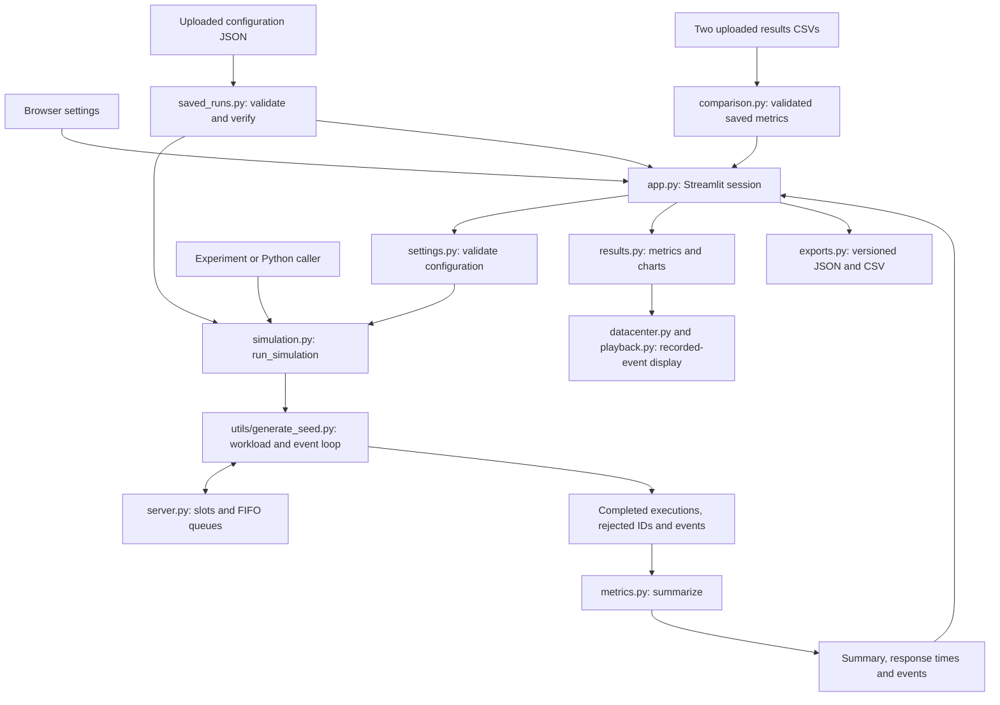

# Demo 3 design document: load balancing simulator

This document covers the implemented D3-01 through D3-07 feature set: two routing
policies, paired policy experiments, saved-run export/replay/comparison, and the
profiled deque improvement. It completes the D3-08 design-document scope using
recorded evidence rather than assumed future outcomes. The submitted Demo 2
snapshot remains on `demo-2`; it does not contain the full Demo 3 feature set.

The implemented source and policy-study artifacts used for this document are
available at revision `9af5b0c8ba7db6f01da4a4a38d05f789e198d78c`.
Earlier captures identify their own source hashes and environments. Publication
or review status on the board is separate from the implementation described here.

## 1. Architecture

The product is a local Streamlit app backed by an importable Python simulation
package. A simulation finishes before results are displayed. The modeled
workload uses no real HTTP requests, external workers, databases or cloud services.



| Module | Responsibility |
| --- | --- |
| `app.py` | Collect settings, run the model and retain the last successful config/summary in session state. |
| `settings.py` | Shared input validation for the form and simulation API. |
| `simulation.py` | Public `run_simulation(config) -> dict`: validate, route, summarize, attach response times and events. |
| `utils/generate_seed.py` | Generate the complete seeded workload, select round-robin or least-active targets, process events and drain accepted work. |
| `server.py` | Request/execution records, bounded FIFO admission, concurrent slots and completion with immediate queue promotion. |
| `metrics.py` | Outcome counts, mean/p95 latency and per-server utilization. |
| `results.py` | Overview charts, metric cards and server details. |
| `datacenter.py`, `playback.py` | Server panels and recorded playback with time controls. |
| `exports.py` | Deterministic version-one configuration JSON, results CSV and shared metrics fingerprint. |
| `saved_runs.py` | Parse/validate saved files and verify regenerated metrics before accepting replay. |
| `comparison.py` | Read-only panels for two result sets, configuration differences and per-server values. |
| `experiments/scale_benchmark.py` | Fresh-process runtime/memory measurements, workload verification and saved evidence. |
| `experiments/compare_policies.py` | Paired low/near/overload/+20% workloads over three seeds, with recorded traces and validation. |
| `experiments/profile_engine.py`, `compare_profiles.py` | Fresh-process profiling and matched before/after timing/output checks. |

The configuration-upload path runs only after the user explicitly requests a
replay. CSV comparison reads already-computed results and never invokes the
simulation. In-session event playback simply advances through an existing log;
configuration replay regenerates a simulation and a new event log.

### Configuration and lifecycle

All times are simulated seconds. Server IDs start at zero. Each request occupies
one execution slot for its full service time.

| Key | Meaning and validation |
| --- | --- |
| `server_count` | Positive integer number of identical servers. |
| `concurrency` | Positive integer execution slots per server. |
| `queue_limit` | Nonnegative integer waiting places per server, excluding running work. Zero disables waiting. |
| `arrival_rate` | Positive finite requests per simulated second. |
| `duration` | Positive finite arrival-window duration; also the utilization window. |
| `service_min`, `service_max` | Positive finite service bounds, minimum no greater than maximum. Equal bounds produce fixed service times. |
| `seed` | Integer; negative values are valid. |
| `policy` | Use `round_robin` or `least_active_requests`. Least-active selects the fewest running requests, breaking ties by lowest server ID; queues do not count and full targets are not skipped. |

The engine generates `N = int(arrival_rate * duration)` requests, IDs `0..N-1`.
Request `i` arrives at `i / arrival_rate`; service time is sampled with a local
`random.Random(seed).uniform(service_min, service_max)`. Generation precedes
routing. A positive rate/window produces an empty trace when their product is
less than one.

Round-robin assigns request `i` to server `i % server_count`, regardless of load.
A free slot starts work. Otherwise the selected server queues it in FIFO order
if space exists, or rejects it. There is no retry or alternate-server attempt.
Completion frees a slot and immediately starts the oldest queued request; the
engine schedules that request's completion.

Least-active-requests instead selects the minimum `(running_count, server_id)`
before each arrival. Admission and every completion/queue promotion update the
in-memory state used by the next decision. Queue lengths are deliberately absent
from the signal. When all one-slot servers are busy, their running counts tie,
so the lowest-ID server can receive more work despite an already-full queue.
Neither policy retries a different target after rejection. This is the defined
basic load-feedback policy, not a general claim of optimal load balancing.

Completions precede arrivals at equal timestamps. Pending completions sort by
`(completion_time, server_id, request_id)`, breaking completion ties by server ID
then request ID. Generated arrivals follow request-ID order. After the last
arrival, accepted work drains until no pending completions remain. The event
clock jumps between events without sleeping.

Recorded events have shape
`(time, server_id, running_count, waiting_count, action, request_id)`.
Counts describe the server after the event. Actions are `started`, `queued`,
`rejected` or `completed`. A completion that promotes queued work includes that
promotion in its counts; it emits no separate start event for the promotion.

### Metrics and returned data

`run_simulation` returns the dictionary below. Configuration remains a separate
input. For raw executions and rejected IDs, the lower-level
`route(**config, events=events)` returns `(completed_executions, rejected_request_ids)`.

| Summary key | Definition |
| --- | --- |
| `completed_count` | Requests completed after fully draining accepted work. |
| `rejected_count` | Requests whose selected server could neither run nor enqueue them. |
| `mean_response_time` | Mean `completion_time - arrival_time` for completed requests, including waiting and draining. |
| `p95_response_time` | Nearest-rank p95: sorted response time at zero-based index `ceil(0.95 * n) - 1`. |
| `per_server_utilization` | Server ID to occupied slot-seconds divided by `concurrency * duration`. Each execution contributes `max(0, min(completion_time, duration) - max(start_time, 0))`. |
| `response_times` | Completed-request response times in completion order. |
| `events` | Ordered admission/completion state changes for playback. |

Latency excludes rejected requests and includes completions after the arrival
window. Both latency values are `None` for no completions; the UI shows `N/A`.
Empty runs have zero counts and utilization. Utilization clips executions to
`[0, duration]`, excluding draining beyond the window. It measures modeled slot
occupancy, not CPU usage; for valid schedules it lies in `[0, 1]`. After draining,
completed plus rejected equals generated requests and every server is idle.
Tests and the benchmark check these properties.

## 2. Design decisions

- **Local Python and Streamlit:** the app runs locally in one Python process.
  Tests and experiment scripts call the same package independently; benchmark
  samples use fresh worker processes. Distributed services would add unnecessary
  operational complexity.
- **Event-driven execution:** jumping between events separates simulated time
  from machine scheduling; threads and sleeps would introduce timing variation.
- **Separate routing and admission:** the engine selects a target; `Server`
  owns slots, queue capacity and FIFO behavior, including rejection on a full target.
- **Repeatability:** a local random generator and new server objects isolate
  runs from each other and global random state. Arrivals use fixed intervals;
  the seed controls sampled service durations.
- **Drain latency, clip utilization:** accepted requests finish before latency
  calculation, while occupancy stays tied to the arrival window.
- **Recorded playback:** replay changes the display clock using saved events;
  it does not re-route requests or change metrics.

- **Explicit load signal and ties:** fewest running requests and smallest-ID
  tie-breaking make policy decisions deterministic. Including queues, rotating
  ties or skipping full targets would change the policy definition. The measured
  admission/latency tradeoff is documented in Experiment 6; those alternatives
  are not silently introduced to improve its results.
- **Versioned portable files:** configuration/seed and schema version live in
  JSON; global metrics and all server utilizations live in CSV. A shared content
  fingerprint links them without relying on a server database. Replay checks
  exported metrics before changing active results; comparison leaves them intact.
- **Narrow measured optimization:** pending arrivals use `collections.deque`
  and `popleft()` rather than a list and `pop(0)`. The entire workload is still
  generated first; the completion list, policies, admission and event order are
  unchanged. Profiling suggested the issue, and matched output fingerprints plus
  unprofiled timings establish the measured improvement (Experiments 3 and 4).

## 3. Setup

Use Git, uv, a terminal and a browser. `.python-version` selects Python 3.12.
`uv sync --locked` creates `.venv`, installs the importable `lbsim` package and
uses `uv.lock`. The October 20 fresh-clone verification used uv 0.11.32,
Python 3.12.13 and Streamlit 1.65.0.
`pyproject.toml` permits Python `>=3.12,<3.15`, but these instructions use the
selected 3.12 environment. No GPU is required. Initial installation needs internet.

Install Git if absent. Install uv using its
[official instructions](https://docs.astral.sh/uv/getting-started/installation/).
For Windows with WinGet:

```powershell
winget install --id=astral-sh.uv -e
```

For macOS/Linux with curl:

```sh
curl -LsSf https://astral.sh/uv/install.sh | sh
```

Open a new terminal so uv is on `PATH`. From a parent directory where you want
the checkout, run these commands (PowerShell or Bash):

```sh
git clone https://github.com/ec528-fall26/load-balancing.git
cd load-balancing
git checkout --detach 9af5b0c8ba7db6f01da4a4a38d05f789e198d78c
uv sync --locked
uv run python --version
uv run python -m unittest discover -s tests -v
uv run streamlit run src/lbsim/app.py
```

The pinned checkout includes all source and evidence referenced here and avoids
accidentally launching the older `demo-2` submission. It is a reproducible source
snapshot, not a requirement to develop on a detached branch. For an existing
checkout containing this implementation, start at `uv sync --locked` in its
repository root. Environment activation and `PYTHONPATH` overrides are unnecessary
because uv installs the package. Open the printed local URL, usually
`http://localhost:8501`. Stop with Ctrl+C. If the port is occupied, append
`--server.port 8502` to the run command.

The existing suite contains 53 tests for validation, lifecycle, routing, metrics,
UI integration, playback, whole-run correctness, exports, verified replay and
saved-result comparison. Success ends with `Ran 53 tests` and `OK`.
Allow roughly 10 seconds for the suite after dependencies are installed.
It runs locally and requires no cloud resources or GPU.
Streamlit AppTest can print `missing ScriptRunContext` warnings during tests;
the assertions and final status determine success.

Verification was performed on Windows 11, AMD64, with 32 logical CPUs. The saved
10,000-request benchmark stayed below 39 MiB peak process memory per worker there.
This is measured usage, not a minimum RAM requirement or a bound for arbitrary
inputs. Linux/macOS instructions are provided but were not executed for this
document's verification.

### Interface

Enter sidebar settings, choose **Round robin** or **Least active requests**, and
select **Run simulation**. A successful run replaces results; invalid submitted settings
show an error and clear prior results. Editing inputs alone does not run the model.

- **Overview:** outcome bars, completed-request latency histogram with p95, and
  per-server utilization.
- **Datacenter:** recorded playback or run-average utilization. Playback starts
  paused, supports play/pause, restart, seeking and 0.25x-10x speed, and includes
  draining. At 1x, one simulated second takes one real second. Racks group eight
  servers schematically; pages show up to 32 servers. Execution and waiting
  stacks are separate. Task-pool counts cover all servers, including those off page.
- **Server details:** utilization values behind the chart. The **Run
  configuration** expander shows settings for the displayed run.

### Short worked example: overload and draining

Use one server, one slot, one waiting place, 4 requests/s, a 1-second arrival
window, both service bounds 1 second, and seed 42. Reproduce it without a browser
with this command from the repository root. Allow roughly 10 seconds including
command startup after dependencies are installed; the four-request simulation
itself is much shorter. It needs only the local Python environment, with no
cloud resources or GPU:

```sh
uv run python -c "from lbsim.simulation import run_simulation; c=dict(server_count=1,concurrency=1,queue_limit=1,arrival_rate=4.0,duration=1.0,service_min=1.0,service_max=1.0,seed=42,policy='round_robin'); s=run_simulation(c); print({k:s[k] for k in ('completed_count','rejected_count','mean_response_time','p95_response_time','per_server_utilization','response_times')})"
```

Expected output:

```text
{'completed_count': 2, 'rejected_count': 2, 'mean_response_time': 1.375, 'p95_response_time': 1.75, 'per_server_utilization': {0: 1.0}, 'response_times': [1.0, 1.75]}
```

| Time (s) | Event | Running / waiting after event |
| ---: | --- | --- |
| 0 | Request 0 starts; completion scheduled at 1. | 1 / 0 |
| 0.25 | Request 1 queues. | 1 / 1 |
| 0.5 | Request 2 is rejected. | 1 / 1 |
| 0.75 | Request 3 is rejected. | 1 / 1 |
| 1 | Request 0 completes; request 1 immediately starts. | 1 / 0 |
| 2 | Request 1 completes; server is idle. | 0 / 0 |

Request 1 waits 0.75 seconds and runs for 1 second: response time is 1.75 seconds.
Mean response time is `(1 + 1.75) / 2 = 1.375` seconds. The slot occupies the
entire arrival window, giving 100% utilization. Completion at 2 seconds contributes
to latency; occupancy after 1 second does not contribute to utilization. UI cards
show `2`, `2`, `1.375 s` and `1.750 s`. Seek to 0.25 seconds to see one running
and one waiting request, then to 2 seconds to see two completed, two rejected
and zero running/waiting.

For a normal run, keep other settings and change both service bounds to 0.1 seconds.
All four requests complete, none are rejected, mean/p95 are 0.100 seconds and
server utilization is 40%.

### Downloading a completed run (D3-03)

Open **Download run** below the results to save configuration/seed as versioned
JSON and results as CSV. The files describe the last completed run, including
when form inputs have been edited but not submitted. CSV contains whole-run
metrics and one utilization row per server. Empty-run latency cells are blank.
See [the export format](run-exports.md) for every field and the real-run example.

The saved-run contract is schema version `1`:

| File | Required data and interpretation |
| --- | --- |
| Configuration JSON | Top-level `schema_version`, 64-character `run_id`, and `config` containing all nine settings, including policy and integer seed. |
| Results CSV | `schema_version`, `run_id`, all nine configuration values, generated/completed/rejected counts, mean/p95 response times in seconds, `server_id` and `slot_utilization`. Exactly one row per configured server, including idle servers. |

Global counts and latency repeat in CSV rows and must be read once, not summed.
Only server ID/utilization vary. Utilization is a fraction, not percent; UI panels
multiply it by 100. No-completion latency is blank in CSV, rather than zero. All
files are UTF-8; loaders accept an optional BOM and limit each upload to 5 MiB.
Missing/extra fields, unsupported versions, inconsistent rows, invalid types,
duplicate server IDs or changed fingerprints produce errors.

The SHA-256 ID covers schema, configuration and exported metrics. It is
deterministic rather than an execution timestamp, and is not authentication.
Files omit original events, individual requests, response-time samples and the
engine/dependency bundle. Replay regenerates those details using the current
model and verifies the exported metrics; an original file alone cannot prove
that an omitted event history is identical. Exact field definitions, accepted
inputs and example files are in [the saved-run contract](run-exports.md).

### Reloading and comparing saved runs (D3-04/05)

In the sidebar, **Replay a saved run** accepts version-one configuration JSON.
Inspect its settings and click **Replay saved configuration** to regenerate the
simulation. Results replace the active run only after their export fingerprint
matches the saved ID. Playback then resets to paused at time zero. Invalid files
or mismatches display errors and preserve current results; the settings form is
independent of loaded settings.

**Compare saved results** accepts two original CSV exports without an active run.
It shows policies, configuration differences, latency, rejection rates, mean
server utilization and per-server tables. Different workload/capacity settings
are flagged. It reads saved metrics without simulating or changing active results.
Both formats are checked for schema, types, consistency and fingerprints, with a
5 MiB per-file limit. See [the saved-run guide](run-exports.md) for exact rules.

## 4. Running the experiments

The existing benchmark measures the full `run_simulation` call, including
generation, routing, event recording, draining and metrics. Each sample uses
a fresh process. Startup/imports and post-run checks are excluded from timing.
Peak memory is the OS process high-water mark, including interpreter/imports,
read before post-run validation; it is not incremental or whole-machine memory.

### Experiment 1: D2-13 round-robin scale baseline

| | |
| --- | --- |
| Supports | Local baseline runtime and peak process memory for the same 10,000-request trace with 10, 100 and 1,000 servers. |
| Setup | From the repository root, install uv and run `uv sync --locked` (Python 3.12 is selected by `.python-version`). |
| Command | `uv run python experiments/scale_benchmark.py --repeats 3 --output experiments/results/d2-13-rerun` |
| Expected runtime | Typically under one minute on the recorded machine; each worker has a 120-second timeout. |
| Expected output | Nine sample lines, followed by `trace.csv`, `samples.csv`, and `report.json` in the chosen directory. A different directory preserves the saved baseline. |

For each invocation, the script generates a reference trace and writes it to the
chosen output directory. Every worker's generated workload hash must match that
reference. The script also verifies seeded replay, request conservation, idle
servers after draining, and consistent deterministic results across repetitions.
These checks do not automatically compare a rerun with the checked-in baseline.
To compare with that baseline, check the trace hash in `report.json` and the
counts, latency metrics and final event times in `samples.csv` against the files
in `experiments/results/d2-13/`. All nine samples matched those deterministic
fields in the October 20 verification. Wall-clock time and peak memory vary by
machine and load. This experiment is a round-robin baseline, not a comparison of
routing policies.

The workload uses 100 requests/s for 100 seconds, seed 42, service times 0.1-1.0
seconds, one slot and ten waiting places per server. Recorded Windows baseline,
three samples per server count:

| Servers | Median runtime (s) | Maximum peak process memory (MiB) | Completed | Rejected |
| --- | ---: | ---: | ---: | ---: |
| 10 | 0.0752 | 35.41 | 1,905 | 8,095 |
| 100 | 0.1351 | 37.79 | 10,000 | 0 |
| 1,000 | 0.1275 | 38.66 | 10,000 | 0 |

See [methodology](../experiments/README.md),
[raw samples](../experiments/results/d2-13/samples.csv),
[machine/configuration report](../experiments/results/d2-13/report.json) and
[trace](../experiments/results/d2-13/trace.csv). Increasing server count also adds
capacity. Ten servers reject most requests. These results do not isolate the
cost of server count or prove 1,000 servers faster than 100.

### Experiment 2: export a real run

Run `uv run python experiments/export_run.py --output experiments/results/d3-03-rerun`
from the repository root. It completes in seconds and writes configuration JSON
and results CSV for a fixed overload case. Expect two completions, two rejections,
mean/p95 response times 1.375/1.75 seconds and utilization 1.0. The checked-in
[example files](../experiments/results/d3-03/config.json) and
[format documentation](run-exports.md) describe the expected output. A separate
output directory preserves those reference files.

### Experiment 3: D3-06 engine profiling

Run `uv run python experiments/profile_engine.py --output experiments/results/d3-07-rerun`
from the repository root. It profiles the current deque implementation at
10,000 requests and a longer
100,000-request workload, with 10/100/1,000 servers and three unprofiled timings
per case. Only the arrival window grows for the longer workload. Allow roughly
30 seconds locally; each fresh worker has a 120-second timeout. No cloud or GPU
is needed. Output: a new `report.json`, six raw cProfile files and one printed
timing per case. The saved historical pre-change capture is separately preserved
in [D3-06 report.json](../experiments/results/d3-06/report.json); running the
current implementation does not recreate that older code.

Profiled and unprofiled runs must produce identical complete-summary fingerprints.
Each run also checks request conservation and idle final servers. Timing excludes
imports, startup, hashing and output; profiled times include instrumentation
cost and must not be compared directly with unprofiled runtime. Saved source
hashes identify the measured code, including files not yet committed at the time
of the historical captures.

The [analysis and narrow D3-07 plan](../experiments/results/d3-06/analysis.md)
identify list front removals as a scaling issue. The saved before-change
capture remains unchanged. At 100 servers, its unprofiled median grew from
0.0389 to 1.0304 seconds for 10,000 versus 100,000 requests (26.5x for 10x more
requests). Combined list-pop self time accounted for 37-48% of profiled time in
the 100,000-request cases. cProfile combines arrival and pending-completion pop
sites, so this is neither an isolated arrival-pop cost nor a predicted speedup.
See the [raw pre-change captures and function statistics](../experiments/results/d3-06/report.json).

### Experiment 4: D3-07 deque improvement

Pending arrivals now use `deque.popleft()` instead of `list.pop(0)`. The entire
seeded trace is still generated before routing. Completion sorting, routing,
queue admission and event ordering are unchanged.

To reproduce the published calculation from the preserved matching captures:

```sh
uv run python -X utf8 experiments/compare_profiles.py experiments/results/d3-06/report.json experiments/results/d3-07/report.json --output experiments/results/d3-07-comparison-rerun.json
```

Comparison takes under a second locally, prints six timing ratios and writes
the specified JSON. `-X utf8` also supports the script's Unicode timing arrows
on Windows terminals with a legacy default encoding. It checks that the two reports have matching Python,
platform, architecture, Streamlit, configurations, outcome/event counts and full
summary fingerprints. It compares unprofiled medians, not instrumented timings.
Source records: [before](../experiments/results/d3-06/report.json),
[after](../experiments/results/d3-07/report.json),
[calculated ratios](../experiments/results/d3-07/comparison.json) and
[interpretation](../experiments/results/d3-07/analysis.md).

| Requests | Servers | Before median (s) | After median (s) | Before / after |
| ---: | ---: | ---: | ---: | ---: |
| 10,000 | 10 | 0.0238 | 0.0186 | 1.28x |
| 10,000 | 100 | 0.0389 | 0.0343 | 1.14x |
| 10,000 | 1,000 | 0.0394 | 0.0351 | 1.12x |
| 100,000 | 10 | 0.8649 | 0.2007 | 4.31x |
| 100,000 | 100 | 1.0304 | 0.3636 | 2.83x |
| 100,000 | 1,000 | 1.0615 | 0.3846 | 2.76x |

Each median uses three fresh-process unprofiled runs. Original timing captures
used macOS arm64, Python 3.12.12 and Streamlit 1.65.0 as recorded in those reports.
These are matched sequential batches on one machine, not the Windows D2 timing
environment; do not divide D2 timings by these timings to claim optimization.
All six complete summaries match before/after. The historical optimization
validation used 39 tests; the integrated suite now has 53.

Experiment 3 can collect a new after-change report on another machine. Comparing
that report directly with the original macOS capture will correctly fail the
environment check if environments differ. To measure a new speedup, collect
both the list-arrival engine and deque engine with this same profiling script,
configuration and Python/dependencies on the same machine, using separate output
directories. The saved source hashes identify the original pair. No new before
capture or unmeasured speedup is assumed by this document.

Removing arrival-list shifts improves these measured cases, especially the
larger traces. It does not establish overall linear complexity: completion-list
front removals/sorting, least-active selection, metrics and full-trace storage
remain. No memory reduction, cloud throughput or policy-superiority claim follows.

### Experiment 5: saved configuration replay and side-by-side results

Run `uv run python experiments/replay_compare.py --output experiments/results/d3-04-05-rerun`
from the repository root. In seconds it writes two exported JSON/CSV pairs and
`verification.json`, checking complete original/replayed summaries and reading
back both CSVs. Both runs have 16 arrivals with the same seed and workload;
round-robin completes/rejects 9/7 requests, least-active-requests 7/9. This checks
the save/replay/compare workflow, not a general policy-performance claim.
Use the [reference files and UI instructions](run-exports.md#reproduce-replay-and-comparison-evidence)
to reproduce the panels. A separate output directory preserves saved evidence.

### Experiment 6: D3-02 paired policy comparison

```sh
uv run python experiments/compare_policies.py --output experiments/results/d3-02-rerun
```

Run from the repository root; allow a few seconds locally, with no GPU or cloud
resources. There are 24 policy runs plus 24 public-API replays: four fixed-load
scenarios, three seeds (42/43/44) and both policies. The fleet has 10 identical
single-slot servers, 10 waiting places each, a 100-second arrival window and
uniform 0.1–1.0 second service. Nominal capacity is 18.1818 requests/s. The rates
are 50%, 90%, 120%, and 90% increased by 20% (108% of nominal capacity).

Output contains 12 reference traces, samples.csv, server-utilization.csv and
report.json with every configuration, seed, workload hash, summary fingerprint
and aggregate. Observed requests must equal the reference for each policy;
validation also checks state-based target selection, capacity, conservation,
FIFO, draining and exact agreement with the public API replay.

The nominal capacity reference is `10 / ((0.1 + 1.0) / 2) = 18.1818` requests/s,
based on expected service time, not a guarantee of zero rejections. Rates are
9.0909 (low), 16.3636 (near capacity), 21.8182 (overload), and 19.6364 requests/s
(near capacity increased by 20%). The last case is an independent run at 108% of
nominal capacity, not a traffic spike during a continuous simulation. Exact
floating-point rates/configurations are preserved in the report.

#### Policy results and variation

Sources: [per-run samples](../experiments/results/d3-02/samples.csv),
[aggregates and configurations](../experiments/results/d3-02/report.json),
[per-server utilization](../experiments/results/d3-02/server-utilization.csv),
[trace files](../experiments/results/d3-02/traces/low-seed-42.csv) (all twelve are
listed by the report), and [analysis](../experiments/results/d3-02/analysis.md).
Each row below averages the three seed results. Ranges are seed minima/maxima,
not confidence intervals. SD is the sample deviation of the three seed means.
The p95 column averages per-run p95s; it is not a pooled request percentile.

| Scenario | Policy | Rejected %, mean [range] | Mean response s, mean +/- SD | Per-run p95 s, mean [range] | Mean utilization % |
| --- | --- | ---: | ---: | ---: | ---: |
| Low | Round-robin | 0.00 [0.00-0.00] | 0.546 +/- 0.010 | 0.953 [0.947-0.962] | 49.45 |
| Low | Least-active | 0.00 [0.00-0.00] | 0.546 +/- 0.010 | 0.953 [0.947-0.962] | 49.45 |
| Near capacity | Round-robin | 0.00 [0.00-0.00] | 0.952 +/- 0.042 | 2.126 [2.023-2.237] | 88.97 |
| Near capacity | Least-active | 2.91 [2.69-3.36] | 1.048 +/- 0.015 | 5.235 [5.137-5.291] | 86.23 |
| Overload | Round-robin | 12.21 [11.55-13.20] | 4.740 +/- 0.141 | 6.912 [6.797-7.084] | 99.50 |
| Overload | Least-active | 22.50 [21.50-23.89] | 1.135 +/- 0.014 | 6.001 [5.924-6.059] | 92.23 |
| Near +20% | Round-robin | 3.65 [3.06-4.58] | 3.720 +/- 0.205 | 6.474 [6.385-6.615] | 98.88 |
| Near +20% | Least-active | 15.44 [14.42-16.40] | 1.124 +/- 0.014 | 5.891 [5.771-5.962] | 90.54 |

At low load both accept every request with zero waiting and matching response
metrics. Aggregate utilization hides imbalance: the mean across seeds of
population server-utilization SD is 0.0254 for round-robin and 0.3463 for
least-active, in fraction units. Idle-server ties favor low IDs, concentrating
light traffic. Those exact per-seed values are in the utilization/report sources.

Near capacity, round-robin rejects none; least-active rejects 2.91% on average
and has worse mean/p95 latency. A running-only count ignores queued work. When
all one-slot servers are busy, every count is one and the lowest-ID tie funnels
new arrivals toward server 0 even if its queue is full.

Under overload and near +20%, least-active has lower completed-request mean
latency but rejects substantially more work. Rejected requests have no response
time in these statistics, so this is an admission/latency tradeoff, not an
overall win. In the saved dataset every rejection occurs while another queue
has waiting room, for both policies; `rejected_with_other_queue_space` in the
per-run samples records the check. Neither policy retries another target.

The experiment therefore supports reporting latency, rejection and utilization
together. It does not justify changing the agreed policy or claiming a universal
ranking. Three seeds, one fleet/service distribution and regular arrivals give
descriptive variation, not statistical significance. No CPU-runtime comparison
between policies, bursty traffic, continuous execution, failures or retries is
measured here. Historical study metadata records macOS arm64 and Python 3.12.12;
deterministic results can be checked separately from machine-dependent timings.

## 5. Claims and limitations

The prototype provides configurable identical servers, fixed-interval seeded
traffic, round-robin and least-active-requests routing, bounded FIFO queues, draining, charts, recorded
playback and a reproducible local baseline.

- The D2 scale baseline is round-robin only; D3-02 now compares both policies
  across four fixed-load scenarios and three seeds. Least-active counts running
  requests only; lowest-ID
  ties can favor a full queue, and idle ties concentrate light traffic on server 0.
- Arrivals are evenly spaced; bursty/exponential traffic is not modeled.
  Request count truncates to `int(arrival_rate * duration)`.
- Concurrency defines capacity. Hardware speeds, CPU/memory pressure,
  failures/reliability, regions, network delay, retries and preemption are not modeled.
- Configuration/results live in Streamlit session state and can be downloaded,
  reloaded for verified simulation, or compared from CSV. There is no server-side
  run library or schema migration. Downloads contain summary metrics, not original
  request traces or playback events. Replay regenerates events; its fingerprint
  verifies only the exported configuration/metrics and is not authentication.
- While playing, playback requests updates every 0.2 seconds; actual refresh
  timing depends on execution and browser load. Short events can fall between
  frames, while replay counts process every event. Racks are display organization,
  not topology.
- The engine retains the complete workload/event log. Arrivals use a deque,
  but pending completions still use list front removals and sorting. There is no
  resource cap for arbitrary configurations;
  large runs can block the synchronous UI or exhaust RAM.
- The D2 scale baseline and deque timings each use one seed/workload family and
  three timing repetitions per case on their recorded machines. D3-02 uses three
  seeds but one fleet/service distribution. Neither dataset establishes cloud
  performance, production guarantees, optimized complexity or general policy rankings.

## 6. Evidence coverage and verification

| Completed implementation scope | Evidence/reproduction entry |
| --- | --- |
| D3-01: state-based policy | [Policy definition](simulation-model.md), [policy tests](../tests/test_policies.py); shared lifecycle and exact events are checked by the suite. |
| D3-02: paired policy study | Experiment 6, its 24 per-run samples, three-seed aggregates and twelve paired traces. |
| D3-03: exports | Experiment 2 and the [version-one file contract](run-exports.md). |
| D3-04/05: replay and comparison | Experiment 5, the [saved verification report](../experiments/results/d3-04-05/verification.json), and [loader/UI tests](../tests/test_saved_runs.py). |
| D3-06/07: diagnosis and measured change | Experiments 3/4; before/after reports, raw profiles, full-summary fingerprints and all six timing ratios. |

The [combined policy/export/replay/comparison verification](../experiments/results/d3-02/integration-verification.json)
records all 24 policy summaries matching their evidence, all 24 exported JSON
configurations replaying to their full original summaries/events, all 24 CSVs
preserving configuration/metrics, and all twelve matched policy pairs rendering
eight comparison metrics without errors. This is automated component verification,
not a claim that a new manual browser check was performed for every policy sample.

The commands above are local and require no cloud service or GPU. New rerun
directories preserve original captures; environment/timestamp/source metadata
may differ on rerun. Compare deterministic trace/summary fields directly and
interpret performance only within matched environments. Demo slides, recording
and release submission remain separate deliverables, outside D3-08.
