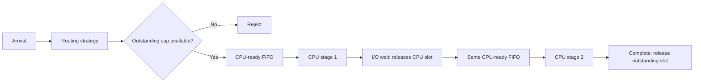

# Simulation model

This document describes the current simulator. The first sections cover simple
one-shot runs. See the later sections for routing, CPU/I/O, sharding, and
server availability. Times shown by the engine are in simulated seconds.

## Data

| Object | Fields |
| --- | --- |
| Config | `server_count`, `concurrency`, `queue_limit`, `arrival_rate`, `duration`, `service_min`, `service_max`, `seed`, `policy` |
| Request | `id` (unique integer), `arrival_time`, `service_time` |
| Server | `id`, `concurrency`, `queue_limit`, `size`, `availability`, running executions, FIFO waiting requests |
| Execution | request, `server_id`, `start_time`, `completion_time` |
| Run summary | `completed_count`, `rejected_count`, `mean_response_time`, `p95_response_time`, `per_server_utilization`, `response_times`, `events` |

Server count and concurrency are positive integers. Queue limit is a nonnegative
integer counting waiting requests only. Duration, rate and service bounds are
positive finite numbers, with `service_min <= service_max`. Arrival times are
finite and nonnegative. IDs are unique within a run. The seed is an integer.
Concurrency sets the number of slots per server. Optional `processing_rates`
scale service speed without changing slot count. See
[Server availability and outages](#server-availability-and-outages) for failure and repair behavior.

The simple one-shot workload uses `int(arrival_rate * duration)` requests
with evenly spaced arrivals starting at zero. Service durations are uniform
between the configured bounds. Each run uses a local seeded generator.

## Routing and event order

The public entry point is `run_simulation(values: dict) -> dict` in
`src/lbsim/simulation.py`. It validates the configuration and returns the run
summary. The lower-level `route` in `src/lbsim/utils/generate_seed.py` takes the
validated configuration and optional event and outage data. Use
`run_simulation` for validation and aggregation.
`completed` contains `Execution` objects in completion order; `rejected` contains
request IDs in arrival order. Pass a list as `events` to collect playback records.
Configuration and these raw lists are not included in the public summary.
Generated count is `completed_count + rejected_count` after draining.

The [routing registry](#routing-strategies) selects a target before admission.
Round robin cycles through eligible server IDs. Least active selects the minimum
`(running_count, server_id)`. Waiting work does not affect that choice, so a tie
can select a full queue. Least outstanding includes queued work in its load
signal. With availability enabled, routing selects from servers that are up.

- Pending completions are sorted by `(completion_time, server_id, request_id)`.
- Completions are processed before arrivals at the same timestamp.
- Arrivals are processed in generated request ID order, with times
  `request_id / arrival_rate`.
- On completion, queued work starts immediately, before the next event is handled.
- After arrivals stop, accepted work drains until every server is idle.

Playback records are tuples
`(time, server_id, running_count, waiting_count, status, request_id)`. Counts
reflect server state after the event, including any queued request started by a
completion. For a simple run without outages, status is `started`, `queued`, `rejected`,
or `completed`. Starting
queued work is represented by the completion's updated counts, rather than a
separate `started` record.

## Server processing rates (A-01)

Each server can have an optional processing-rate multiplier. A request's
`service_time` is the work it needs on a rate-1.0 server, a server with rate `r`
runs it for `service_time / r` seconds. Rate 2.0 finishes the same request in
half the time. Rate 0.5 takes twice as long

- Set it with `processing_rates`: one positive, finite number per server, in
  server-ID order. Leaving it out, or giving all 1.0, is the original uniform
  model and returns the same nine-field config and identical results
- Rates change only execution time. The seeded trace (arrivals and service
  times) is identical, uniform and mixed fleets can be compared on the same
  requests
- Round robin and least active do not read rates when choosing a target. Faster
  service can free a slot earlier. Least-active ties still favor the lowest ID.
- Utilization is still occupied slot time in the arrival window. A fast server
  at 100% does more work than a slow one at 100%
- On **Setup → Infrastructure**, enter one comma-separated multiplier per
  server in **Processing rates**. When resizing a custom fleet, existing
  server IDs retain their rates and new servers start at 1×. Version-one
  exports reject mixed rates because the format cannot represent them.

Worked example (`tests/test_processing_rates.py`): 2 servers, 1 slot, 1 waiting
place, 4 requests/s for 1 s (arrivals at 0, 0.25, 0.5, 0.75), service 1.0 s,
rates `[2.0, 1.0]`

| Policy | Where request 3 goes | Response times (s) | Mean | p95 |
| --- | --- | --- | ---: | ---: |
| round_robin, uniform `[1, 1]` | queues on server 1 | 1.0, 1.0, 1.5, 1.5 | 1.25 | 1.5 |
| round_robin, `[2, 1]` | queues on slow server 1, starts at 1.25 | 0.5, 0.5, 1.0, 1.5 | 0.875 | 1.5 |
| least_active, `[2, 1]` | tie at 1 running: lowest ID, fast server 0, starts at 1.0 | 0.5, 0.5, 1.0, 0.75 | 0.6875 | 1.0 |

Response times are listed in completion order. On the fast server request 0
ends at 0.5, exactly when request 2 arrives, completions run first,
request 2 starts at once instead of queueing.

## Server API (implemented)

- `submit(request, now)` returns `started`, `queued`, or `rejected`, plus the
  new execution when work starts. Submission must occur at the arrival time.
- `complete(request_id, now)` returns the completed execution and, if the queue
  was nonempty, the execution that just started. It must be called at the
  scheduled completion time.
- The engine must schedule each returned execution's completion event, including
  work started from a queue. The server does not advance time automatically.
- `running` and `waiting` expose immutable snapshots for policies and debugging.

A free slot starts work immediately. Otherwise a request joins the waiting queue
if there is room, or is rejected. There are no retries or alternate-server attempts.
Requests run without preemption for their full service duration.

## Metrics contract (implemented)

Response time is `completion_time - arrival_time`; waiting time is
`start_time - arrival_time`. Latency statistics include completed requests only,
including those completed during draining. Report mean and nearest-rank p95
(sorted value at index `ceil(0.95 * n) - 1`), or `null` for no completions.

Per-server utilization is occupied slot-seconds within `[0, duration]`, divided
by `concurrency * duration`. Clip execution intervals to that window; draining
does not contribute after the window ends. An interrupted attempt counts until
the outage stops it and contributes no completion latency. This measures modeled
slot occupancy.
After draining, `completed + rejected == generated`, and every server is idle.

## Data examples

These examples use a fixed service duration so the output is easy to check.

```python
from lbsim.server import Execution, Request, Server
from lbsim.settings import validate_config
from lbsim.simulation import run_simulation

config = validate_config({
    "server_count": 1, "concurrency": 1, "queue_limit": 1,
    "arrival_rate": 1.0, "duration": 4.0,
    "service_min": 3.0, "service_max": 3.0,
    "seed": 42, "policy": "round_robin",
})
request = Request(id=0, arrival_time=0.0, service_time=3.0)
server = Server(id=0, concurrency=1, queue_limit=1, size=None, availability=None)
admission = server.submit(request, now=0.0)
assert admission.status == "started"
assert server.running == (Execution(request, 0, 0.0, 3.0),)
assert server.waiting == ()

# This creates fresh servers, independently of the example server above.
result = run_simulation(config)
assert result == {
    "completed_count": 3,
    "rejected_count": 1,
    "mean_response_time": 14 / 3,
    "p95_response_time": 6.0,
    "per_server_utilization": {0: 1.0},
    "response_times": [3.0, 5.0, 6.0],
    "events": [
        (0.0, 0, 1, 0, "started", 0),
        (1.0, 0, 1, 1, "queued", 1),
        (2.0, 0, 1, 1, "rejected", 2),
        (3.0, 0, 1, 0, "completed", 0),
        (3.0, 0, 1, 1, "queued", 3),
        (6.0, 0, 1, 0, "completed", 1),
        (9.0, 0, 0, 0, "completed", 3),
    ],
}
```

## Worked server example

This hand-written trace uses different service durations. It exercises the
`Server` API directly; it is not the trace generated by the config above.
A/B/C/D correspond to integer request IDs 0/1/2/3.

One server, one slot, one waiting space:

| Time | Event | Result |
| --- | --- | --- |
| 0 | A arrives, service 3 | A starts; completion at 3 |
| 1 | B arrives, service 2 | B waits |
| 2 | C arrives, service 1 | C rejected; queue full |
| 3 | A completes | B starts; completion at 5 |
| 3 | D arrives, service 1 | D waits behind running B |
| 5 | B completes | D starts; completion at 6 |
| 6 | D completes | Server idle |

Response times are A=3, B=4, D=3 seconds. There are three completions and one
rejection. With an arrival window of 4 seconds, utilization is 100%; the final
completion is at 6 seconds. Mean response time is 10/3 seconds and p95 is 4.

## Run the checks

From the repository root:

```sh
uv run python -m unittest discover -s tests -v
```

`tests/test_server.py` checks the hand-written server trace above.
`tests/test_policies.py` checks changing load,
completion-before-arrival routing, ties, full queues, multiple slots and identical
seeded workloads between policies.

## Routing strategies

`src/lbsim/policies.py` owns the policy registry, topology eligibility, labels and
strategy factories. `settings.py`, the Streamlit menu and all three engines use
that registry. A simulation creates a fresh strategy; no mutable strategy is
shared between runs. Engines call `choose()` before admission and notify
`update(target)` after running counts change. Admission, event ordering, workload
sampling, completion handling and queues remain engine responsibilities.

| Identifier | Topology | Selection and ties |
| --- | --- | --- |
| `round_robin` | Single pool and regions | Advance through eligible target indices from zero, including after rejection. |
| `least_active_requests` | Single pool | Fewest running requests, then lowest server ID. Waiting work is excluded; no fallback on rejection. |
| `least_loaded` | Regions | Minimum `(running + queued + outbound in transit) / slots`, then client RTT, then region index. |
| `nearest` | Regions | Minimum client RTT, then region index. |
| `nearest_under_load` | Regions | Nearest region (client RTT, then index) whose `(running + queued + outbound in transit) / slots` is below 0.9. If every region is at or above 0.9, falls back to `least_loaded`. |
| `least_outstanding` | Single pool | Fewest running + CPU-queued + I/O-waiting requests, then lowest ID. |
| `power_of_two` | Single pool and CPU/I/O research | Sample two distinct targets; fewer CPU-active requests, first sampled on ties. |

Least-active and least-outstanding own bounded indexed minimum trees: O(log n) running-count updates
and O(1) selection. Round robin and regional strategies do not allocate that
index. The regional model still represents aggregate pools, not independent
per-server schedules. `nearest_under_load` is the one added routing rule: it
follows the mentor's example of preferring low latency until a region passes
about 90% load, then accepting extra latency to avoid overloading it.

### Frontend contract

Next.js uses a generated TypeScript projection of the same registry for menu
labels and policy types. It requires no extra runtime request or Python in the
browser. Keep the generated file in Git so frontend-only installs still work.
After changing policy metadata, run from the repository root:

```sh
uv run python scripts/generate_policy_metadata.py
uv run python scripts/generate_policy_metadata.py --check
```

To add a policy, implement a `RoutingPolicy`, register its factory and supported
topology labels, regenerate metadata and add behavioral tests. Registering a name
does not automatically implement it for a different target model.

### Verification

```sh
uv run --locked python -m unittest discover -s tests -q
npm run typecheck --prefix src/frontend
npm run test:api --prefix src/frontend
```

`tests/test_policy_parity.py` checks 171 snapshots against SHA-256 fingerprints
captured before this refactor at `58cfcd3`. It covers batch and incremental
single-pool runs with both policies, three seeds, mixed compute rates, zero and
bounded queues and multiple slots; the three then-existing regional policies with travel;
small event budgets, traffic-rate changes and full draining. The fingerprints
include exact metrics and event/state data, not just outcome counts. Existing
policy, saved-run/replay, API and engine tests remain intact. Registry tests also
compare indexed selection with a simple minimum oracle after 1,000 seeded load
updates, verify per-run isolation and reject policies from the wrong topology.

The main Lab supports staged CPU/I/O requests in single-pool one-shot and live
runs. See [the integration guide](#cpuio-in-the-main-lab) for admission, stage accounting
and model-specific UI and recording contracts.

## CPU/I/O in the main Lab

Single-pool runs support two independent execution choices (one-shot/continuous)
and two request models (simple service duration/CPU → I/O wait → CPU). Regions
retain their existing aggregate-pool model; CPU/I/O is not offered for regions.

### Configure and run

Open **Library** and choose **CPU to I/O, step by step**, **I/O-heavy routing** or
**CPU-heavy routing**. **Live I/O-heavy traffic** and **Live CPU-heavy traffic**
open Setup in continuous mode. All templates prefill editable settings.

Setup has its own page at `/setup`, grouped into **Infrastructure**, **Traffic
and routing**, and **Execution**. The summary shows capacity, traffic and routing
beside the run action. CPU/I/O details expand within Traffic and routing. There is
no preset/custom mode: edit a template directly. Successful runs open the Lab at
`/simulator`; errors leave the form available. **Edit configuration** returns to
Setup while keeping completed results. **Compare this run** uses the run's
configuration, while **Compare current setup** on Setup uses the draft.

Live Pause/Stop and traffic changes stay in Lab; speed and restart are under
**Session options**. Draft edits do not stop or reconfigure a live session.
Starting a replacement continuous run explicitly replaces the existing worker.

The service-time range samples total demand before queueing; the CPU fraction
is split equally before/after I/O. Server processing-rate multipliers scale CPU
stages only. All servers share a finite I/O resource with a FIFO queue. A call
holds one I/O slot during service and releases its server CPU slot. This models
one shared dependency, not a physical disk or network. **Shared I/O bottleneck**
provides an intentionally constrained example.

Mixed workloads draw a 90% or 10% I/O fraction per request, with a configurable
probability of I/O-heavy requests. A separate seeded type stream preserves the
offered workload across policies and I/O capacities; `workload_sha256` covers all
offered requests, including rejected ones.

Each admitted request belongs to one server until completion. CPU1 and CPU2 share
one non-preemptive CPU-ready FIFO. I/O releases its CPU slot but retains an
outstanding admission place. A full selected server rejects without alternate
routing or retry. There is no separate CPU-queue admission limit in this mode;
all unfinished work is bounded by the outstanding cap. The legacy `queue_limit`
setting is preserved for switching back to the simple model and is hidden while
CPU/I/O is selected.

### Routing and signals

All strategies use the central Python registry and fresh per-run state:

- Round robin advances through servers even after rejection.
- Least active counts CPU-active requests; CPU queues and I/O wait are excluded.
- Least outstanding counts CPU-active + CPU-queued + I/O-waiting requests.
- Power of two samples two distinct servers and chooses fewer CPU-active requests;
  equal counts choose the first sampled. Routing RNG uses `seed + 1000000`, separate
  from workload generation. This specified variant is not an Envoy conformance claim.

Both minimum policies use a bounded indexed tree, with lowest-server-ID ties.
The simple model also supports least outstanding (running + waiting) and P2C.
The original two policies retain their prior behavior on the simple model.

### Visualization and metrics

Datacenter racks and server details show CPU activity, CPU-ready queues, I/O
in service, I/O queued and outstanding counts/caps. Resource pressure separates
CPU occupancy, shared I/O capacity and admission capacity. A server with idle CPU and I/O wait is not
labeled idle. Task-pool counts include I/O in conservation and future arrivals.
One-shot playback fetches the selected-time state for only the visible server
page. It does not download the whole event trace.

Latency includes CPU queueing, I/O and execution through full draining, and
excludes rejected requests. The latency breakdown separates CPU service, CPU queue, I/O service and I/O
queue means for completed requests only. One-shot p95/histogram cover all completions. Continuous p95/histogram cover
the bounded recent response window (at most 2,000), while mean response and mean
CPU queue delay cover all completions since session creation. CPU occupancy is
modeled slot occupancy, not host CPU utilization. One-shot utilization clips to
the arrival window; continuous utilization covers the elapsed session.

Continuous history stays capped at 240 points and server pages at 64 (the UI
requests 32). Sessions retain outstanding state, not full completed traces. Pause
freezes the clock; resume continues; zero traffic drains existing work. Live
traffic controls apply immediately at processed simulated time. Draft model,
policy and I/O-share edits apply on the next session, as other setup edits do.

### Recorded data and compatibility

Simple-model configuration and six-field events keep their original shape.
CPU/I/O adds `request_model: cpu_io`, `io_fraction` (0–0.99) and a positive
`outstanding_limit`, `io_capacity` (1–4096; default 64) and optional
`io_heavy_probability` (0–1). Ten-field staged events append per-server total I/O,
outstanding, active I/O and queued I/O counts to the six legacy fields. Actions
`cpu_to_io`, `io_started` and `io_to_cpu` are internal
transitions, not new arrivals. CPU completions precede I/O completions, then
arrivals; same-kind ties follow stable insertion order. One-shot uses exactly
`int(arrival_rate * duration)` generated arrivals and drains accepted requests.

Recordings remain disk-backed with count/bytes/TTL quotas, stable event pages
and indexed selected-time snapshots. Browser saves retain all model settings;
Compare clones retain them and allow policy/I/O-share/admission changes. Version-1
JSON/CSV exports cannot represent stages and explicitly reject CPU/I/O rather
than dropping settings. No silent schema migration is introduced.

### Verify

```sh
uv sync --locked
uv run --locked python -m unittest discover -s tests -q
npm --prefix src/frontend ci
npm --prefix src/frontend run typecheck
npm --prefix src/frontend run test:library
npm --prefix src/frontend run test:live
npm --prefix src/frontend run test:comparison
```

Start the Python API and Next.js using the existing API/frontend setup guides.
Browser tests in `src/frontend/tests/cpu-io-templates.spec.ts` exercise the actual API,
exact one-shot I/O state, save/reload, live controls and zero-traffic drain.
`tests/test_staged.py` checks hand-derived traces, parity with the standalone
CPU/I/O experiment, compute multipliers, FIFO, minimum-policy load signals,
capacity/conservation, paging, rate changes, bounded retention and API validation.
The pre-refactor simple-model snapshot fingerprints remain in the full suite.

See the [verification commands](../README.md#verification) for the current suite.
`tests/test_shared_io.py` checks exact
shared-dependency timelines, FIFO/capacity invariants, mixed-workload identity,
resource accounting and bounded retention. Browser checks cover dedicated Setup/Lab navigation,
direct template editing, shared I/O pressure, saved configurations, playback
and live drain. These are local correctness checks, not production-capacity or
physical-network claims.

## CPU/I/O routing research (A-24)

This is a small standalone experiment prompted by the professor's feedback.
The experiment keeps its original routing and workload model. The web app also
provides a standalone preview of that model. It is advanced research; no new Demo 3
commitment or mentor agreement is implied.



The server has a finite number of non-preemptive CPU slots and a separate maximum
number of outstanding requests. A request stays assigned to its initial server.
Both CPU stages join the same ready FIFO. I/O completion rejoins that queue
without needing new admission capacity. The I/O resource itself is unbounded:
this models a delay, not shared database contention or network traffic.

For example, requests arriving at 0 and 0.1 seconds, each needing one second CPU,
two seconds I/O, then one second CPU, complete at 4 and 5 seconds with one CPU
slot. At time 2, both requests are in I/O, zero are CPU-active and two are still
outstanding. A cap of two would reject a new request even with the CPU idle.

The Python policy registry has a separate `cpu_io` topology. Round robin,
least-active and P2C are reused/registered there. Least-active and P2C observe
**CPU-active requests**, not all outstanding HTTP requests. This is a deliberate
experimental load signal; it is not a claim to reproduce Envoy's least-request
semantics. Existing web-app policy eligibility and menus are unchanged.

P2C samples two distinct servers and selects the one with fewer CPU-active
requests; equal counts choose the first sampled server. Its per-run RNG is
separate from workload generation. This is a defined P2C variant, not a proxy
conformance test. No control-plane service is added: configuration selects the
strategy; the event loop executes each per-request data-plane choice.

### Run and inspect

After installing the repository's locked dependencies:

```sh
uv run --locked python experiments/compare_cpu_io.py --output experiments/results/a-24-rerun
uv run --locked python -m unittest discover -s tests -q
```

The experiment takes seconds on a local CPU. It compares eight one-slot servers,
eight outstanding places per server, CPU-heavy/I/O-heavy/mixed requests, three
traffic rates and three seeds. Each of 27 generated traces is shared exactly by
all three policies. All 81 results are rerun for exact deterministic equality.
No cloud, GPU or extra package is needed. An explicit rerun directory preserves
checked-in evidence. Outputs are `samples.csv` (81 rows), `traces.json` (27 trace
inputs), `report.json` (configurations, source and result hashes) and `analysis.md`.

Mean/p95 latency cover completed requests through draining and must be read
alongside rejection. CPU occupancy, mean I/O-waiting, mean CPU-ready queue and
mean outstanding counts integrate over the arrival window. CPU occupancy is a
modeled slot measure, not actual host CPU usage. Per-event assertions enforce
CPU bounds, admission caps, unique lifecycle completion and conservation.

The checked-in [results](../experiments/results/a-24/analysis.md) are limited to
regular arrivals, one fleet size, no network model and three seeds. They are not
a general policy ranking, fault-tolerance result or performance benchmark.
Tests include exact hand-calculated timelines, FIFO re-entry, tied completions,
admission during I/O wait, workload identity, P2C's sampled-choice rule, resource
accounting and final draining. Existing simulator compatibility tests still run.

### Initial findings

In the I/O-heavy 400 requests/s case, three-seed mean rejection is 0% for round
robin, 30.31% for CPU-only least-active (range 30.0–30.6%), and 3.38% for P2C
(range 3.175–3.65%). Mean modeled CPU occupancy is 49.7%, 34.6% and 48.1%,
respectively. CPU-only selection can route into an outstanding cap while CPU
slots are available elsewhere. Lowest-index ties also concentrate work; these
results combine that tie behavior with the load signal, rather than isolating
one cause. Successful-request p95 stays around 119 ms, hiding the rejection gap
if reported alone.

P2C is not universally better: with CPU-heavy work at 100 requests/s, round robin
rejects 7.27% versus P2C's 11.17%. This standalone experiment evaluates those three policies. The main Lab
also supports least outstanding. Adding CPU/I/O stages does not establish fault tolerance.

### Main Lab extension

The standalone A-24 experiments above retain their original unlimited I/O-delay
model so the checked-in results stay reproducible. The main Lab now offers finite
shared I/O concurrency, FIFO dependency queueing, mixed request types and
least-outstanding routing. See [CPU/I/O Lab](#cpuio-in-the-main-lab). The earlier results
should not be presented as measurements of this extended model.

## Fan-out and stragglers

Sharded service models a fixed amount of useful work per parent. The Lab runs
one, two, or four shard calls per parent in one-shot mode. Compare runs one
versus four calls on the same seeded workload, with and without either a CPU
slowdown or a shard outage.
The earlier A-04 probe increased work with fan-out and answers a different
workload question.

Each parent first queues for coordinator CPU. It sends one coalesced call or
two or four calls in parallel or in series, then releases the coordinator slot
while waiting. Shard
placement rotates by parent ID so the one-shard case uses the same four-server
fleet. Every shard has a CPU slot, an I/O slot and an eight-request admission
limit. A shard call queues for CPU, releases it during I/O, then returns to the
CPU queue. The coordinator queues for CPU again after the last reply.

The configured round trip is divided between send and reply. A rejection
reaches the parent after the reply leg. A parent succeeds if its join finishes
at or before the deadline. Requests already sent continue to drain after parent
failure unless the shard itself goes offline. Consumed service is counted.
The model omits link contention, retry, replication and packet loss. The
slow condition multiplies CPU service time on the configured shard while
preserving its nominal demand and I/O time.

### Parallel and serial calls

Setup can send all required shard calls together or send them one at a time.
Both modes assign the same pieces to the same shards. Serial waits for a
successful reply before sending the next call and leaves later calls unsent
if the parent fails or reaches its deadline. Each sent call pays its own
network round trip. Other parents can still make progress while one waits.

Compare can isolate call order at two or four shards with the same workload,
CPU settings and deadline. If an outage is configured, each order runs once
with the outage and once with all shards online.

### Seeded outages

Set the outage duration to a value from 1 to 1,000 ms to take one shard offline
during the arrival window. Zero keeps all shards online. The seed chooses the
shard and start time independently of the workload. At the start of the outage,
the shard drops queued, executing and outbound calls to it. New calls to that
shard fail during the outage. Replies already sent can still arrive, and other
shards continue processing. The shard accepts new work at recovery. Work on
the interrupted CPU and I/O slots is counted only up to the interruption.

A parent records an outage failure if an outage error reaches it before a
different terminal outcome. The per-shard outage count includes affected calls
from parents that already timed out or failed elsewhere. Compare holds arrivals,
work, CPU slowdown and outage schedule fixed across the applicable cases. It
tests one and four calls per parent, each with and without the outage.

For example, at 50 parents/s over four seconds, seed 42 and normal CPU speed,
a 500 ms outage takes shard 0 offline around 3.238 s. Seven parents fail with
one required shard call and 25 fail with four required calls. Both no-outage
baselines complete all 200 parents.

### Reproduce

From the repository root with Python 3.12 and the locked environment:

```sh
uv sync --locked
uv run --locked python experiments/compare_fanout_pipeline.py > /tmp/fanout-pipeline.json
uv run --locked python -m unittest discover -s tests -p 'test_fanout_pipeline.py' -v
```

The experiment runs in seconds on a laptop. It needs no external services.
For the interactive view, start the existing Python API and Next.js frontend,
then choose Sharded service in Setup. Run the simulation to inspect outcomes,
shard queues and one parent's event timeline in the Lab. Choose Compare this
run to carry its settings into the four-case experiment.

### Expected results

Seeds 42–44 each offer 200 parents at 50 parents/s, with a 200 ms deadline, 4 ms
shard RTT and a 4× CPU slowdown on shard 0 in the slow condition. P95 is the
arithmetic mean of the three per-seed p95 values for successful parents.

| Case | On time / offered | Timeouts | Mean seed p95 (ms) | Backend service per success (ms) |
| --- | ---: | ---: | ---: | ---: |
| 1 shard, normal | 600 / 600 | 0 | 73.35 | 59.49 |
| 1 shard, slow shard | 558 / 600 | 42 | 182.08 | 80.01 |
| 4 shards, normal | 600 / 600 | 0 | 26.00 | 59.49 |
| 4 shards, slow shard | 600 / 600 | 0 | 112.46 | 74.32 |

No admission rejections occurred at these settings. The normal cases spend the
same total backend CPU and I/O service per success, while four-way parallelism
reduces elapsed latency. The slow shard raises the tail even in the four-way
case. Compare the deadline success count alongside p95, since p95 excludes
timeouts and rejections. These results apply to the modeled workload and
placement, and do not rank load-balancing policies.

## Server availability and outages

Optional config fields `availabilities` (one value in (0, 1] per server) and
`mean_repair_time` (MTTR in seconds, one shared value or one per server,
default 1) let servers fail in one-shot runs and continuous sessions of the
simple request model.

- Availability A is the long-run fraction of time a server is up. Each server
  alternates up and down periods drawn from exponential distributions with
  means MTBF = MTTR × A / (1 − A) and MTTR, so MTBF / (MTBF + MTTR) = A.
- Each server draws its periods from its own seeded stream
  (`src/lbsim/availability.py`), separate from the request trace and routing
  draws. Every server starts up. One-shot runs generate the whole window first
  (`outage_schedule`); continuous sessions (`ContinuousSimulation`) draw the
  next period whenever a server goes down or up. With the same seed, a
  continuous session's first T seconds have the same outages as a T-second
  one-shot run.
- Continuous sessions also accept the `fail_server` command (value: server
  number). It takes that server down immediately for exactly its MTTR (1 s when
  no availability is configured); invalid or already-down servers are ignored.
  Session snapshots gain `outages`, `rejected_breakdown`, and per-server `up`,
  `measured_availability`, `outage_count`, `rerouted`, and `dropped` once
  outages are possible.
- At equal timestamps a completion is handled first, then a server going down
  or up, then an arrival.
- Routing policies skip down servers. When a server fails, its running and
  queued requests are re-routed through the policy and restart, keeping their
  original arrival time; a request no server can take is rejected. When every
  server is down, arrivals are rejected.
- Playback records add statuses `server_down`, `server_up`, `rerouted`,
  `reroute_rejected` (a dropped request no server could take), and
  `no_server_up` (an arrival rejected because every server was down). Summaries
  add `rerouted_count`, `outages`, `per_server_availability`,
  `rerouted_by_server`, and `rejected_breakdown` (`queue_full`, `no_server_up`,
  `reroute_rejected`, summing to `rejected_count`).
- With every availability at 1 the fields are dropped from the config and
  results are identical to runs without them.
