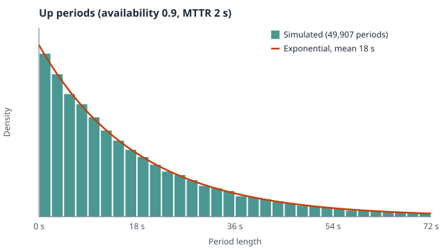
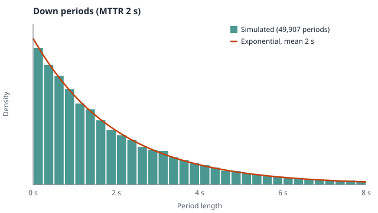

# Availability validation

**28 of 28 checks passed** (50 seeds per mean check unless noted; 37 s).

> Theory says 36% of requests should find every server down (two servers at 40% availability); the simulation measured 35.9% ± 0.5% (95% interval) over 50 seeds.

A mean check passes when theory lies within 4 standard errors of the measured mean; ± values are 95% intervals.

## 1. Availability converges to the setting

| Check | Theory | Measured | Result |
| --- | --- | --- | --- |
| Availability 0.5 (20,000 s window) | 0.5 | 0.4993 ± 0.0011 | PASS |
| Availability 0.8 (20,000 s window) | 0.8 | 0.7995 ± 0.0012 | PASS |
| Availability 0.95 (20,000 s window) | 0.95 | 0.95 ± 0.00064 | PASS |
| Spread after 300 cycles = A(1-A)sqrt(2/n) | 0.007348 | 0.007441 | PASS |
| Spread after 3,000 cycles = A(1-A)sqrt(2/n) | 0.002324 | 0.002492 | PASS |

Availability 0.9, MTTR 2 s, 200 seeds per window:

| Window | Cycles | Mean measured | Spread | Theory spread |
| --- | --- | --- | --- | --- |
| 60 s | 3 | 0.9042 | 0.0670 | 0.0735 |
| 600 s | 30 | 0.9004 | 0.0222 | 0.0232 |
| 6,000 s | 300 | 0.9007 | 0.0074 | 0.0073 |
| 60,000 s | 3,000 | 0.9001 | 0.0025 | 0.0023 |

The mean stays at the target while the spread shrinks like 1/sqrt(cycles), as the central limit theorem predicts.

## 2. Up and down periods are exponential

| Check | Theory | Measured | Result |
| --- | --- | --- | --- |
| Up period mean | 18 | 18.03 ± 0.16 | PASS |
| Up period std / mean (exponential: 1) | 1 | 1.008 | PASS |
| Up periods fit an exponential (KS distance; theory column = 1% critical value) | 0.007296 | 0.002372 | PASS |
| Down period mean | 2 | 2.011 ± 0.018 | PASS |
| Down period std / mean (exponential: 1) | 1 | 0.9985 | PASS |
| Down periods fit an exponential (KS distance; theory column = 1% critical value) | 0.007296 | 0.006154 | PASS |

## 3. Every server down at once = product of (1 - A)

| Check | Theory | Measured | Result |
| --- | --- | --- | --- |
| Time with every server down (A = 0.4, 0.4) | 0.36 | 0.3585 ± 0.0049 | PASS |
| Arrivals finding no server up (A = 0.4, 0.4) | 0.36 | 0.3588 ± 0.005 | PASS |
| Time with every server down (A = 0.5, 0.6, 0.7) | 0.06 | 0.05755 ± 0.0021 | PASS |
| Arrivals finding no server up (A = 0.5, 0.6, 0.7) | 0.06 | 0.05765 ± 0.0022 | PASS |

## 4. Failures per window = T / (MTBF + MTTR)

| Check | Theory | Measured | Result |
| --- | --- | --- | --- |
| Failures in 6,000 s (A = 0.9, MTTR = 2.0 s) | 300 | 300.6 ± 4.9 | PASS |
| Failures in 6,000 s (A = 0.5, MTTR = 1.0 s) | 3000 | 3003 ± 9.8 | PASS |

## 5. Trends

| Check | Theory | Measured | Result |
| --- | --- | --- | --- |
| Lower availability -> more rejections (A = 0.95, 0.8, 0.6, 0.4) | — | 0.0001, 0.008133, 0.07109, 0.2338 | PASS |
| Same availability, longer MTTR -> fewer outages (MTTR = 0.5, 2, 8 s) | — | 2394, 597, 150.8 | PASS |
| ... but the same downtime (MTTR = 0.5 s) | 0.2 | 0.1995 ± 0.0023 | PASS |
| ... but the same downtime (MTTR = 2.0 s) | 0.2 | 0.2003 ± 0.0046 | PASS |
| ... but the same downtime (MTTR = 8.0 s) | 0.2 | 0.2051 ± 0.013 | PASS |
| 1 server(s) at A = 0.6: arrivals finding none up (theory 0.4^1) | 0.4 | 0.4052 ± 0.012 | PASS |
| 2 server(s) at A = 0.6: arrivals finding none up (theory 0.4^2) | 0.16 | 0.1627 ± 0.0085 | PASS |
| 3 server(s) at A = 0.6: arrivals finding none up (theory 0.4^3) | 0.064 | 0.06509 ± 0.0045 | PASS |
| 4 server(s) at A = 0.6: arrivals finding none up (theory 0.4^4) | 0.0256 | 0.0261 ± 0.0024 | PASS |
| More servers -> fewer 'every server was down' rejections | — | 0.4052, 0.1627, 0.06509, 0.0261 | PASS |

## 6. Continuous sessions match one-shot runs

| Check | Theory | Measured | Result |
| --- | --- | --- | --- |
| Continuous = one-shot: same outages and 'no server up' rejections (10 seeds, 300 s) | 0 | 0 | PASS |
